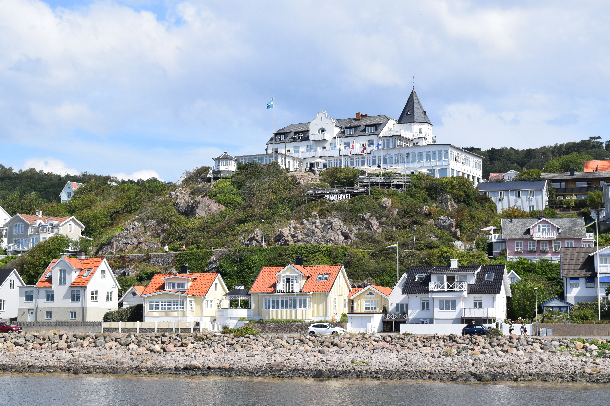
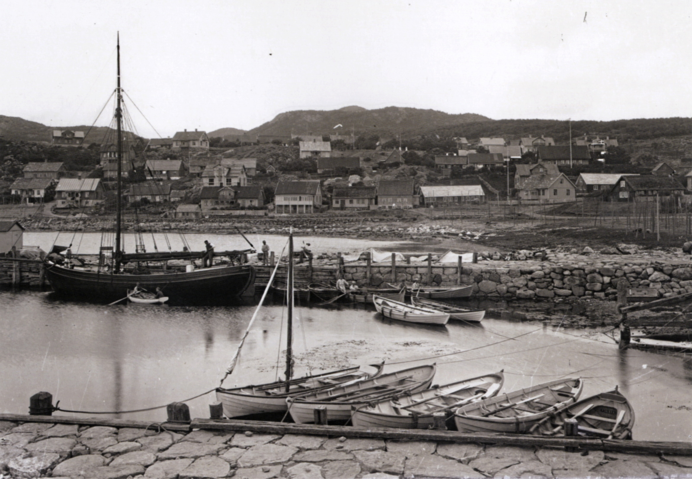
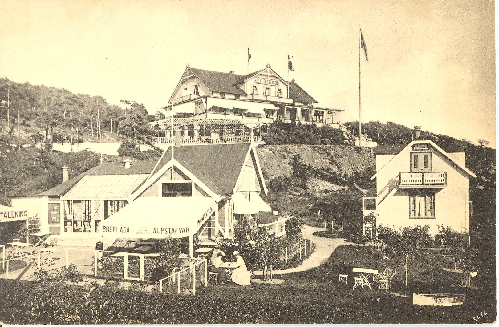
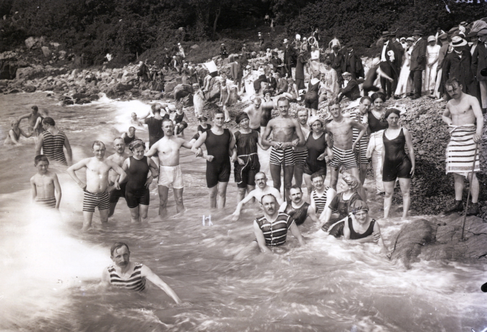
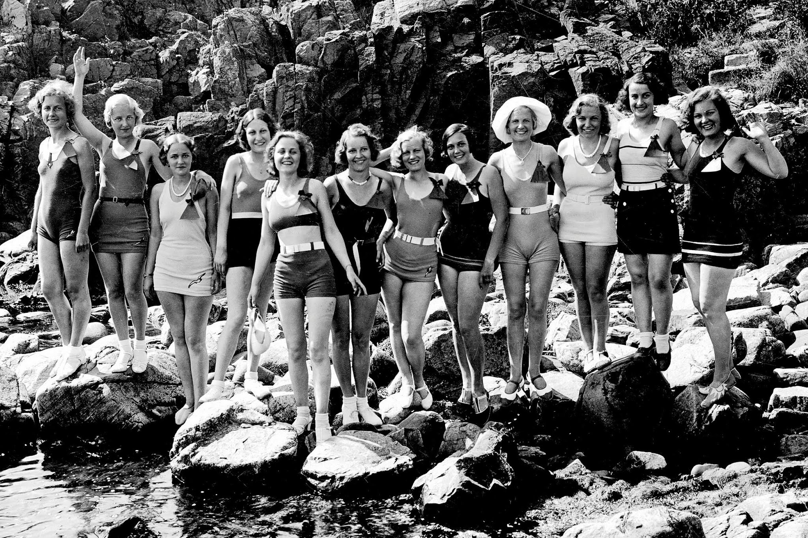
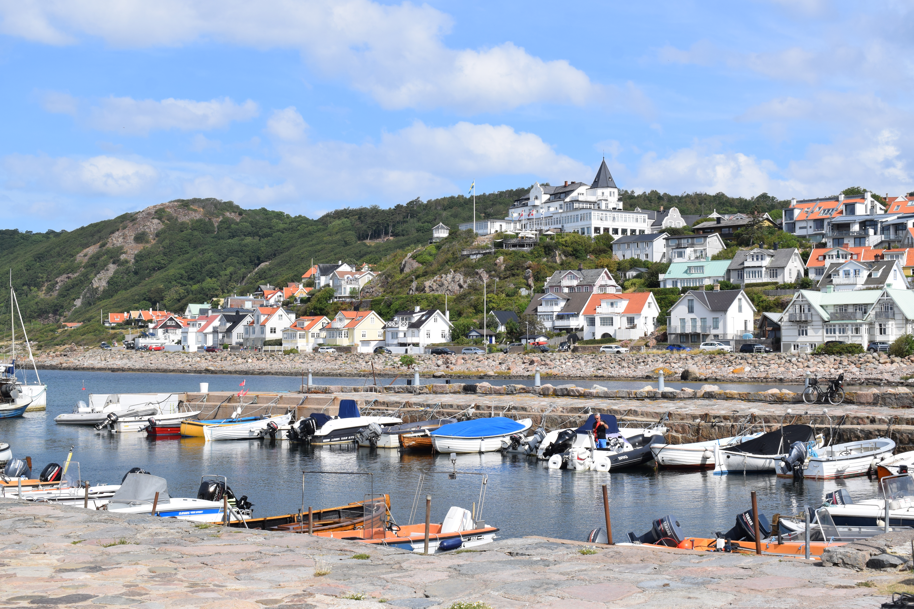
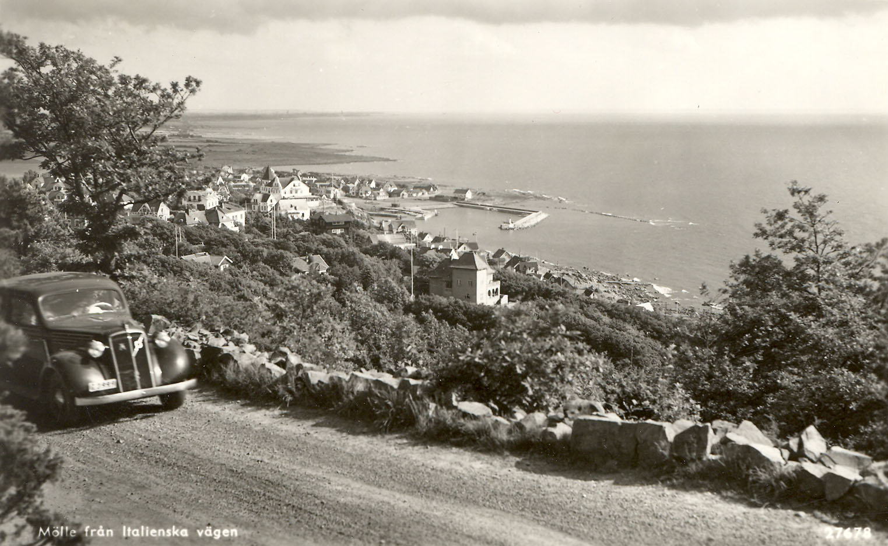
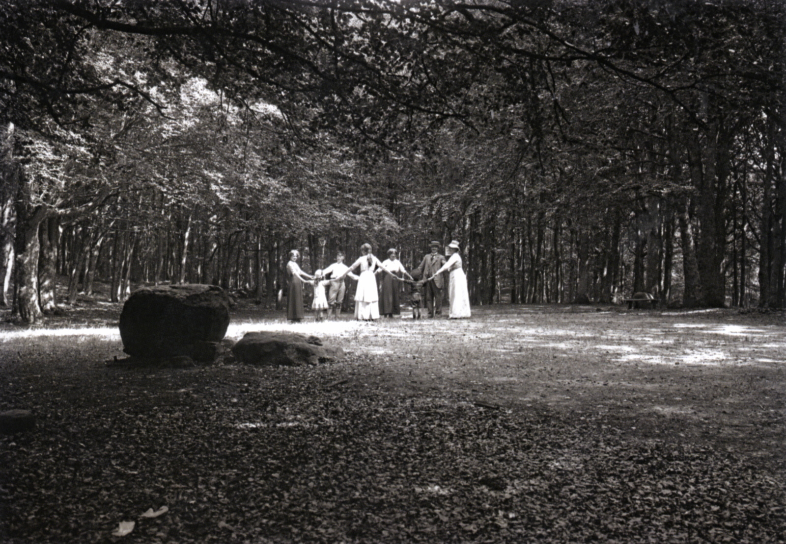

Если из Хельсинборга отправиться на север и достичь шоссе № 111, то дорога, в конечном счете, приведет вас в небольшую прибрежную деревню, вздымающуюся по склонам к подлескам Куллаберга. Россыпь белоснежных домов с черепичными крышами и сияющая гладь пролива Каттегат, отделяющая далекий датский берег от местной гавани, очерченной каменным причалом и стройными мачтами яхт, придают этому месту особый курортный шарм, а скалистые холмы рельефного заповедника, покрытые зарослями можжевельника, дикой жимолости и терновника — дополняют пейзаж, чем-то схожий с ландшафтами французской Ривьеры. А ведь это Сконе - самый плоский лен Швеции.

#### История возникновения

Согласно археологическим данным, этот регион был заселен уже в каменном веке. Первое письменное упоминание о рыбацкой деревне Мёлле (Myllæ) найдено в датском документе 1491 года. Похожие названия встречаются и в полиптиках более позднего времени, а в 1820 году это место впервые именуется Mölle. Предположительно, название произошло от водяной мельницы, находившейся у ручья, протекающего через деревню. Она могла быть расположена к северу от нынешнего Куллаберсвегена (Kullabergsvägen): на археологической карте 1860 года в этой точке есть слово «мельница» (Mölle)

В 1569 году Мёлле состоял из десяти рыбацких домов и фермы, которую позднее дополнила еще одна, таким образом образовав деревню. В 1680-х годах здесь насчитывалось в общей сложности 22 дома, а на рубеже 1800-х их число возросло до 66.

С момента основания, Мёлле, как впрочем и весь регион Сконе, принадлежал датской короне и лишь в 1658 согласно Роскилльскому мирному договору эта область отошла к Швеции. В начале XVIII века Карл XII опасаясь, что датчане могут попытаться вернуть себе Сконе, приказал укрепить побережье. Как напоминание, в Мёлле сохранился так называемый редут Карла XII.

Характер Мёлле, как рыболовного поселка, изменился после крупного пожара в августе 1890 года, в результате которого 16 из 129 домов деревни превратились в пепел. Две фермы, которые являлись сердцем деревни Мёлле, также сгорели. Огонь привел к тому, что новые каменные дома в стиле вилл заменили рыбацкие и фахверковые дома с соломенными крышами.

Рыбацкая деревушка Мёлле, до появления больших отелей

**\**
**Зарождение туризма**

Первые туристы приедут в Мёлле на лошадях по проселочной дороге в середине 1500-х годов. С 1840-х Мёлле становиться туристическим направлением и в начале 1870-х годов деревня приобретает статус одного из первых в Швеции туристических курортов.

Пожар 1890 года, как не странно, стал своего рода вехой в истории этого места, косой которая срезав травяной покров неожиданно обнажила благодатную почву для зарождения небывалых возможностей: на месте былых хижин стали вырастать новые здания, адаптированные к возрастающей популярности Мёлле у туристов. Многие, из этих недавно построенных вилл, имели специальных постамент, позволяющий хозяивам и домочадцам жить в подвале дома. К летнему сезону часть жителей деревни перебералась в такие подвалы или сараи, чтобы иметь возможность сдавать в аренду свои комнаты. В Мёлле появились отели и гостевые дома для размещения потока туристов. Были они не дешевыми — их могли позволить себе лишь достаточно состоятельные люди, который часто путешествовали всей семьей и со своими слугами, включая экономку и няню. В те времена путешествия не были столь комфортыми и длились долго, так что, как правило, господа останавливались в деревне на несколько недель подряд.

После строительства пристани в 1880-х годах, сюда, в летнее время, начали ходить пароходы из Копенгагена и Мальмё. Некоторые из туристов, принадлежавших к буржуазному и зажиточному классу, очарованные Мёлле и его окрестностями, впоследствии стали жителями деревни. Однако, большинство посетителей приезжало в Мёлле из близлежащих городов, чтобы побывать здесь в однодневной поездке. Многие из них хотели остаться подольше в этих живописных краях, что привело к увеличению спроса на возможности размещения.

В 1890-х годах эта востребованность сделала Мёлле известным, как один из первых морских курортов Швеции. Туристов привлекали в Мёлле живописные виды пролива Каттегат и дикая природа, окружающая скальные образования Куллаберга, а так же сканская кухня, обычно в виде шведского стола, и конечно же морское купание.

В немалой степени популярности Мёлле способствовало то, что германский император Вильгельм II 30 июля 1907 года остановился здесь на своей яхте "Гогенцоллерн" на несколько дней. Новость получила огласку и искушенные немецкие туристы обратили свой взор на шведскую деревню, стремительно превращающуюся в престижный морской курорт.

Отель Elfversson, 1905 год

В результате такой растущей сезонной популярности, существующие отели и гостиницы быстро престали справляляться с туристическим наплывом, что естественно привело к необходимости строить новые здания. В начале 1910-х годов в деревне было уже пятнадцать отелей, а количество жителей в течение летнего сезона составляло примерно 3000 человек, по сравнению с 600-700 постоянными резидентами.

Но не только красота местного ландшафта, кристально чистые воды морского залива, превосходный сервис и инфраструктура привлекали сюда туристов из разных стран в преддверии Первой мировой войны.

[Читать на сайте: Из истории туризма в Швеции](iz_istorii_o_zarozhdenii_turizma_v_shvetsii.html)

**«Грех в** Мёлле»

Этот знаменитый снимок был сделан Питером П. Лундом (Peter P Lundh), придворным фотографом, имеющим эксклюзивные права на съемку в Рансвике (пляж, о котором еще будет идти речь) от барона Gyllenstierna из замка Крапперуп (Krapperups slott). Работы этого талантливого шведа в немалой степени способствовали росту популярности Мёлле. Предприимчивый фотограф продавал свои фотоснимки туристам в качестве приятных воспоминаний об их пребывании в Мёлле. Другие фото были напечатаны в массовых изданиях и в виде открыток. Сегодня коллекцию можно увидеть в Хёганас (Höganäs), неподалеку от Мёлле.

На снимке запечатлен весьма скандальный, по тем меркам, момент прошлого Мёлле. И речь вовсе не о диковинных купальных костюмах, которые, безусловно, бросаются в глаза современному человеку. Дело в том, что на фото мужчины и женщины купаются вместе!

Так выглядели *безнравственные* туристы в начале XX-го века в Мёлле

На рубеже веков о Мёлле стал распространяться слух как о месте распущенности и бесстыдства. Одной из причин возникновения такой молвы были фотографии и открытки Питера П Лунда, посвященные мужчинам и женщинам, которые купались вместе у скал на пляже Рансвик, за пределами гавани. Это стало некой сенсацией, привлекающей многих любопытных и смелых людей в Мёлле. Несмотря на то, что как джентльмены, так и дамы носили купальники, которые сильно закрывали тело (судя по снимкам не всегда), считалось, что это явление выходило далеко за рамки пристойности. Любопытный факт: на пляже, с целью соблюдения приличий, был даже поставлен контроллер, он же спасатель, который следил за тем, чтобы переодевания происходили только в специально установленных кабинках.

Из-за такой репутации Мёлле, многие гости, которые останавливались в *греховной деревне*, желали сохранить конфиденциальность. Вот почему они регистрировали свою корреспонденцию в соседнем Арилде (Arild).

Вероятно, находка со смешанными купаниями имела немецкое происхождение: в Германии совместные купания уже не были в новинку. Это распространилось и на Мёлле в годы после 1905 и с этим пришло выражение "*грех в* *Мёлле*".

Слухи о безнравственном поведении в Мёлле вызвали ажиотаж у туристов. Многие из постоянных гостей морского курорта возвращались каждый год и оставались там на несколько недель. Отелям нужно было развлекать постояльцев и они проводили множество мероприятий, как например, морские прогулки по гротам и пещерам Куллаберга и, конечно же, танцевальные вечера.

Девушки в купальниках того времени

В 1907 году в Швеции была основана первая регулярная автобусная линия между Хёганасом и Мёлле. Автобусы имели десять мест для сидения и шесть мест для тех, кто не прочь переваливаться с ноги на ногу. Зачастую, пассажиров помещалось больше, чем имелось предусмотренных мест и все равно этого было недостаточно. Чтобы решить эту проблему в 1910 году на Вальборгской ярмарке была торжественно открыта железнодорожная линия Хёганас - Мёлле (Möllebanan), стоимостью 700 000 шведских крон.

До 1914 года Мёлле был настолько популярен среди немецких посетителей, из так называемого лучшего общества, что создавалось впечатление, будто это немецкая колония. Однако с началом Первой мировой войны количество туристов из Германии резко сократилось и курортная деревушка быстро потеряла важный источник дохода. Тем не менее, датчане и шведы продолжали посещать курорт.

В межвоенные годы туризм в Мёлле получил новый сильный подъем — гости из Германии вернулись, хотя и не в такой же степени как раньше. Длилось это не долго, и с захватом власти нацистами в 1933 году, строгие валютные правила Рейха положили конец почти всему немецкому иностранному туризму.

Послевоенный период характеризовался длительным снижением интереса к приморскому туризму. Одной из причин этого было, например, общее увеличение автобусных маршрутов. Стали доступнее рейсы в южные страны. Автомобильное движение с 1950-х годов так же сильно влияло на туризм, а в 1960-х годах доступность авиатранспорта означало, что пассажиров можно было легко доставить в отдаленные места. Люди стали более мобильными и начали осваивать новые туристические направления. К этому времени благосостояние жителей Мёлле достигло определенного достатка и они оказались уже не так зависимы от арендного дохода и летних гостей. Туристический спад привел к тому, что большинство отелей и гостевых домов были вынуждены затворить свои двери, а в 1963 году был закрыт и Möllebanan.

**Туризм в Мёлле сегодня**

В наши дни, Мёлле утратил свою былую туристическую популярность. Тем не менее, это все еще роскошный курорт. Большая часть посетителей — это однодневные туристы и люди имеющие здесь свою летнюю резиденцию. Согласно оценкам, в Мёлле насчитывается около 800 постоянных жителей и 2200 тех, кто проживает в деревне летом.

Пристань Мёлле 2019 г.

Сегодняшний туризм в Мёлле отличается от старого купального. Это характеризуется, например, пристанью для яхт и полем для гольфа. Среди прочего, Мёлле является туристическим аванпостом на пути в заповедник Куллаберг, который стал весьма популярным местом среди дайверов и скалолазов, а также тех, кто желает насладиться изумительными видами на залив и впечатляющими пейзажами окрестных скал, взойти к маяку Куллен (Kullens fyr), побродить в березовых и буковых рощах или постичь волшебный блеск и умиротворение таинственных болот удивительного полуострова.

В Мёлле есть шесть действующих летних отелей, два близлежащих поля для гольфа, популярный кемпинг, несколько мест для дайвинга и часто посещаемая пристань для яхт, рядом с которой находиться все еще действующий маяк построенный в 1881 году. В деревне можно найти пару художественных галерей, одна из которых расположена на старой железнодорожной станции. Напротив находится керамика Мёлле. Продуктовый магазин в данный момент отсутствует.

Еще, неподалеку, имеется часовня открывшая свои двери прихожанам в 1935 году.

Многие по-прежнему посещают Мёлле, чтобы искупаться в море и позагорать. Рядом с деревней есть три общественных пляжа:

1. *Solviken -* расположен у подножия природного заповедника Куллаберг, к северо-западу от Мёлле. Это прекрасное место для плавания с маской. В кристально прозрачной воде можно рассмотреть причудливых морских звезд, крабов и другую живность. Отсюда, по старой тропе можно дойти до следующего пляжа, Рансвик, где столетие назад мужчины и женщины, вопреки всяким приличиям и морали, впервые в истории Швеции стали купаться вместе.

2. До пляжа *Ransvik* также можно добраться по итальянской дороге идущей от шоссе № 111 до маяка Куллен. Дорога названа так, видимо потому, что к западу от Мёлле идет по склону горы и напоминает итальянские дороги (см фото)

3. *Fågelviken* находится примерно в 200 м к югу от гавани. Бухта для птиц, которая является относительно мелкой, что отлично подходит для тех, кто хочет купаться с детьми. Там же есть короткий песчаный пляж.

Итальянская дорога в начале 1950-х годов

**Несколько слов от автора**

Безусловно, Мёлле - это жемчужина Сконе и одно из живописнейших мест Швеции. Эта потрясающая, сонная деревушка чудесное место чтобы отдохнуть от беспощадной суеты и мракобесия современной жизни. Мне нравиться приезжать сюда, проводить время у причала и на пляже, а также наслаждаться прогулками по заповеднику и плавать среди скал. Здесь отличные рестораны и фешенебельные отели, но главное, что волшебство здесь повсюду. Мёлле - это особое подлинное место с интересной историей. Ощущение гармонии и умиротворения не покидает вас, когда вы приезжаете в Мёлле. Я бы хотел, чтобы Мёлле не утратил своей самобытности и не слишком модернизировался.

Лесная поляна, Куллаберг, фото Питер П Лунд.

**Что почитать (на шведском)**  
1. [Det vackra huset i Möllebergsbacken : om 150 år av turism vid Kullabergs fot](https://www.bokus.com/bok/9789185517114/det-vackra-huset-i-mollebergsbacken-om-150-ar-av-turism-vid-kullabergs-fot/)  
2. [”Här ha vi det ljufveligt”. Hotell och pensionat i Mölle och Arild genom alla tider](https://www.boktugg.se/bok/9789198033304/har-ha-vi-det-ljufveligt-hotell-och-pensionat-i-molle-och-arild-genom-alla-tider/)
