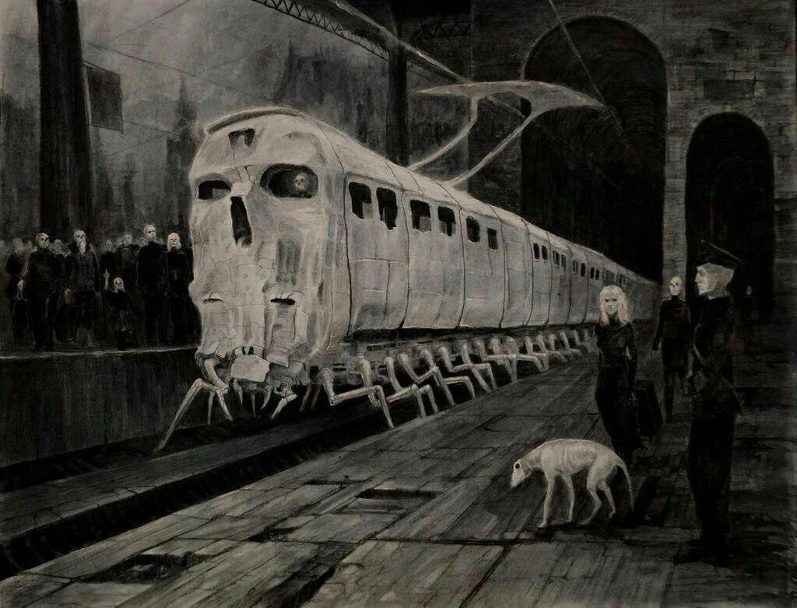

Сегодня в цеху было тихо и холодно. Двенадцать человек отсутствовали на местах. По крайней мере, так сказал смотритель. Он был раздражен и энергично размахивал руками перед какими-то людьми, вероятно из какого отдела. Не самый приятный тип, но другого не имеем.

Повеяло тоской, впервые за долгие годы после стачки.

Прежде я не видел главного токаря таким подавленным, — этого славного, веселого и застенчивого парня; гору мышц, сочетающуюся с невиданной добротой и утонченностью; настоящего знатока своего дела. Никогда он не выглядел так обреченно, кроме, пожалуй, того дня, когда девушка из бухгалтерии с сияющей улыбкой похвалила его костюм, надетый в честь какого-то праздника.

Тогда, помню, он долго ни с кем не разговаривал, ходил какой-то удрученный и задумчивый. Что до костюма, то мы его больше не видели. Наверное выкинул.

Но это было лишь однажды. Хотя, стоит сказать, это вопиющее нарушение всех условностей и негласных правил по которым живет завод. Тем, кто сидят в кабинетах, не следует спускаться сюда. Они застыли среди бумаг и компьютеров, в оцепенении, а здесь внизу кипит жизнь — так должно оставаться. А из-за всяких там дешевых шуточек, производство, годами работающее как единый слаженный механизм, может просто, в один внезапный момент, встать.

Не вышел Коля, фрезеровщик, тот самый, который потерял пару пальцев в том году. Сколько себя помню, это был единственный день, или лучше сказать несколько часов, когда он не работал. По нему можно было часы сверять и если ты пришел в цех, а его нет на месте, значит ты пришел в выходной. Но не в этот раз.

Из-за отсутствия Коли было как-то не по себе. Паутина на мутных окнах, казалось, дребезжала больше обычного. Поскольку нас было мало, смотритель экономил свет и станки в полумраке выглядели надломленными и поникшими, погруженными в свои тени и механические мысли. Выроненный случайно ключ колокольным звоном прорезал тишину, эхом блуждая по цеху. Я вспомнил, что на завтрашний бутерброд едва ли хватит масла. А еще, подумал, что могут ведь и завод закрыть.

Кто-то запустил станок и раздалось жужжание. Кажется, где-то там, где раковины.
