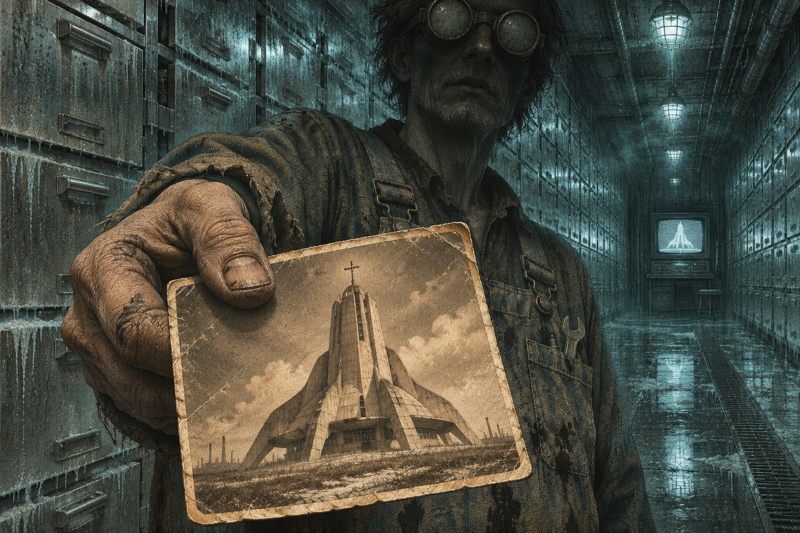

Я вышел из пустого коридора через надломленный гранитный портал. Туман клубился над перекошенными изгородями рваными клочьями, словно был порождением неконтролируемой химической реакции, и дальше лениво стелился во мраке, скрывая местами очертания железобетонных исполинов, норовивших выглянуть из-за завесы желто-серых испарений. Пройдя добрых восемьдесят метров, я заметил, как нависшая над ландшафтом вязкая пелена — больше похожая на тревожно колышущуюся студенистую взвесь — начала редеть, обнажив свинцовые облака, в которых зияла трещина. Сквозь нее, к моему изумлению, пробился дерзкий луч солнца. Он триумфально озарил пространство впереди, и мир, до того фрагментированный, обрел более упорядоченную форму.

Грубые, многоярусные мосты корежили пространство невдалеке и походили на скелеты обрюзгших и сломанных механизмов, застывших в судорожном бессилии; силуэты полуразрушенных цехов грозно чернели, обтянутые рваной патиной, а перед ними, в мутной луже, тонул остов ржавого нефтеналивного танкера, беспомощно черпающего жижу под собой, отчего корма его грузно торчала вверх, доминируя над уставшими козловыми кранами.

У меня не хватило мужества подойти к трясине, потому что я знал: где-то там, под навалами плит, был запечатан беспредельный котлован, в глубине которого, сквозь туман и сумрак, проступали бесчисленные уровни неописуемых металлических сооружений, уходящих вниз, будто в чрево самой земли.

Я прошел еще несколько десятков метров вдоль полотна железной дороги и вдруг остановился. Прямо передо мной в складках растрескавшегося бетона трепыхалось растение. Хрупкое, до безобразия живое в этом мертвом месте, оно каким-то чудом пробило себе путь к свету сквозь массив индустриального декаданса, иссеченный трещинами.

Без сомнения, это была судьбоносная встреча. Но, как это часто бывает, момент был неподходящим.

Растение, привлекшее мое внимание, вблизи оказалось всего лишь сухой и цепкой колючкой. Впрочем, чего еще можно было ожидать от этого палисадника из армированного бетона, чугунных конструкций и пропитанных нефтью резервуаров?

Я отправился дальше. Через какое-то время среди серых плит и ржавых линий горизонта проступил вход в стационарный рефрижератор — массивный, как гроб для вселенной.

Пройдя по бетонному основанию, я подошел к двери, и она с металлическим скрежетом распахнулась, безошибочно определив мою поступь.

Внутри было холодно. Все стены и ряды между ними заполняли нержавеющие ящики, а в нише, в конце зала, светился бледный, бездушный экран. Рядом с ним дежурил какой-то индивид. Высокий, в выцветшем и испачканном грязью форменном комбинезоне, утратившем не столько свой цвет, сколько смысл. От него тянулся шлейф тяжелых смазочных материалов. Его нечесаные волосы были похожи на половую тряпку в инвентаре уборщика на складе горючих веществ, на лице — круглые защитные очки, заляпанные минеральными отложениями и мазутом. В руке он держал металлический ключ — или что-то, что когда-то им было.

Он повернулся ко мне, когда я приблизился на пару метров.

— Смотри, что я нашел. Это для тебя, — сказал он и почти сразу добавил: — Валялось в каких-то развалинах.

Он вложил мне в руку карточку и, не дожидаясь ответа, ретировался, растворившись в холодном отражении уставшего металла.

Я посмотрел. Это была старая фотография. На ней — здание странной, почти невозможной формы. Оно напоминало космический корабль, застывший в момент взлета и увенчанный крестом.

Никогда мне не приходилось видеть ничего подобного. Вероятно, реликт какой-то исчезнувшей эпохи, когда люди еще пытались смотреть вверх на звезды, мечтать и ждать перемен, а не рыскать, как крысы, по бесплодной земле в поисках ничтожных монплезиров.

Я подошел к экрану, и камера, расположенная чуть выше в стене, считала мое лицо. Символы пробежали по глянцевой поверхности, система задумалась… может быть, из-за сомнений, а может, такова была ее процедура. Через несколько минут один из ящиков в огромной стене из нержавеющей стали открылся с сухим, деловым щелчком.

Забрав свой пакет, я тотчас же отправился обратно.

К этому времени холод начал проникать под кожу. Хорошо, что дверь не заклинило, как это уже бывало с другими, — мне доводилось видеть тела, которые вытаскивали наружу после подобных происшествий. Покрытые инеем, они выглядели не как покойники, а как неудачные антропоморфные заготовки. Примерно такое же впечатление производили валявшиеся в тронном зале районного исполкома груды старинных скульптур, некогда созданных как памятники каким-то выдающимся людям, чьи имена давно позабыты.

По дороге обратно мне никто не встретился. И ничего не произошло. Только сгущающийся мрак да тихий перезвон цепей на товарных вагонах на мгновение удостоились моего внимания.

Вход в дом был похож на зияющую червоточину в брюхе бетонного исполина. Ворота давно заржавели и больше не закрывались, потому по коридорам и этажам часто носился ветер, в основном холодный и сырой. И если раньше вестибюль освещался тусклыми лампами, давая возвращающемуся в потемках обитателю хоть какое-то ощущение прибежища, то сейчас в нем царила тьма, нарушаемая только медленно мигающей кнопкой вызова лифта.

Я нажал эту кнопку, и в шахте затрепетали шкивы и тросы. Беспокойный ротор вращался где-то наверху, и его уставшие внутренности жалобно скулили. Вскоре примчался лифт, хотя меня каждый раз удивляло, как он еще работает. Стоя в одиночестве внутри этой жестяной коробки, я думал о том, что однажды застряну в ней, и некому будет прийти и вызволить меня из заточения, некого будет позвать на помощь.

Наконец двери открылись — лифт доставил меня до моей секции, и я быстро покинул его, пока он не передумал.

Дверь, карточка, мигание светодиода — я оказался в своей берлоге и тут же запер за собой замки и засовы. Мир в этот момент стал предсказуемым и привычным — какое же это блаженство, когда все тревоги и страхи в одночасье нейтрализуются под убедительный аккомпанемент хорошо смазанного запорного механизма, чей финальный щелчок возвещает о смене режима выживания на режим царствования. Хотя и это состояние не всегда стабильно — например, подкрадется исподтишка мысль о том, что в любой момент может прорвать какая-нибудь дряхлая труба, зашитая в стене, — и все, прощай сон. Но если попривыкнуть, то можно постараться не фокусироваться на таких вещах, и жизнь становится вполне сносной.

Обжитое, но недолюбленное пространство состояло из залов, обставленных артефактами прошлого, где каждая вещь сохраняла форму контейнера чего-то некогда важного, но лишенного содержания.

Первым делом я занял кресло в дальнем углу комнаты, у пыльного узкого окна. Достал из сумки пакет с питательным компостом — совсем не холодным, что казалось почти невозможным, — и загрузил его в систему питания.

Загорелась подсветка циферблата, который строптиво выдал какие-то монохромные полоски. Затем он словно пришел в себя и начал деловито выводить системную информацию, после чего прозвучало оповещение о переходе системы в диалоговый режим.

Я устроился поудобнее, надел шлем трехмерного отображения и сказал:

— Запускаем программу визуализации.

Раздался скрежет недовольной функции.

— А теперь… нарисуй для меня прекрасные пасторальные луга и рощи, залитые солнцем, волнами нисходящие к бирюзовому морю; небо — голубое и ясное. А еще пусть по дороге, ведущей куда-то вдаль, топают дети… пусть они смеются. И пусть над полевыми цветами летают бабочки. А в центре всего этого возвышается…

Взволнованный, я снял шлем и посмотрел на фотокарточку. В это время гофрированный кабель случайно опрокинул стакан с содовой, и тот безучастно покатился куда-то по полу. Там ему и место — уже неделю мозолил глаза.

Я положил драгоценный снимок в пасть сканера и нажал кнопку.

— Используй это изображение.

Система приняла запрос и зашевелилась. Мир начал подгружаться.

И вот я уже стоял перед тем самым зданием — и не знал, было ли это до нас… или после.
