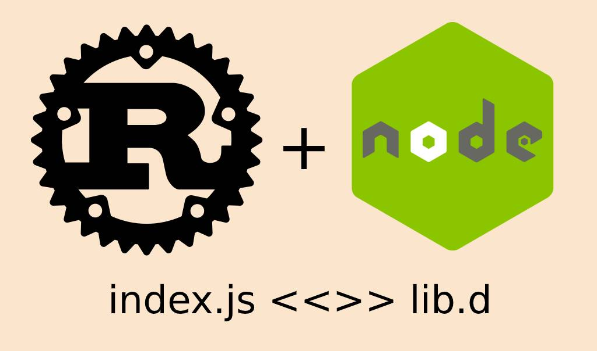

 Возьмем гипотетическую задачу: у нас есть рабочий проект на **Node.js** и мы хотим оптимизировать работу некой функции, производящей сложные вычисления. Принято решение сделать это с помощью **Rust** - низкоуровневого языка программирования, который справляется с той же задачей гораздо быстрее.

Разные подходы могут быть задействованы для решения этой задачи (динамические библиотеки, C++ аддоны Node.js и др).

В данной статье я хочу рассмотреть использование FFI \[1\] (Foreign Function Interface) и C-совместимой библиотеки написанной на Rust \[2\]. Этот способ не является самым эффективным по производительности, но тем не менее, может дать неплохой прирост с точки зрения оптимизации.

Приведенный здесь пример, однако, служит лишь для демонстрации того, как можно организовать взаимодействие Node.js и Rust, к самой описанной выше задаче он отношения не имеет.

## Часть первая: *Обмен строками*

*Задача: произвести обмен строками между Rust-библиотекой и Node.js, чтобы проиллюстрировать взаимодействие.*

# Часть вторая: *Структуры*

*Задача: использовать структуры, для обмена данными и результатом между библиотекой и Node.js*

> *В финальном примере я решил объеденить эти две части в одну.*

## Node.js

***В настоящий момент работает только для версии 16.18.1***

Напишем сценарий для Node.js, который обращается к динамической библиотеке и вызывает ее функции с передачей параметров и выводом возвращаемых значений.

В качестве зависимостей мы будем использовать:

- ffi-napi - Foreign function interface, расширение для загрузки и вызова динамических библиотек
- ref-napi - дополнительная зависимость, который поможет нам работать с некоторыми C-подобными типами в JavaScript
- ref-struct-napi - предлагает реализацию типа Struct для Node.js

Рассмотрим полный листинг index.js

[GitHub Gist](https://gist.github.com/Mefistophell/48d621098d3e79d3119eca0cf80ad6b7)

Несмотря на то, что код достаточно легко читаем, некоторые строки все же требуют пояснений.

**\*7** Для того, чтобы производить обмен данными с динамической библиотекой, мы должны вооружиться специальными типами, которые эта библиотека будет понимать. Мы не можем использовать JS массив и вместо этого мы будем работать с указателями (Pointer \[3\]). Для этого нам потребутся модуль (C++ addon) [ref](http://tootallnate.github.io/ref/) (который среди прочего позволяет создавать свои собственные типы), а так же модули реализующие типы [структура](https://github.com/TooTallNate/ref-struct) и [массив](https://github.com/TooTallNate/ref-array). В этой строке мы создаем C-подобный тип массива размером в 2 элемента, который будет содержать значения типа int64.

\*10 Поскольку функция multiply библиотеки будет возвращать структуру (struct), представление которой в JavaScript отсутствует, нам потребуется модуль [ref-struct](https://github.com/TooTallNate/ref-struct), позволяющий работать с этим типом данных и, в частности, преобразовать его в объект JavaScript. В этом месте сценария мы создаем структуру OutputType, (подобно Rust или C) с тремя полями типов: int64,OutputArrayType,CString. Последний тип представляет собой так называемую *Нуль-терминированную строку* (NULL-terminated C-style strings). Такой строкой мы сможем пользоваться в библиотеке.

\*24 Для инициализации доступа к функциям библиотеки мы используем вызов ffi.Library, который имеет следующую сигнатуру:

    ffi.Library(путь_к_библиотеке, { имя_функции: [ возвращаемый_тип, [ тип_аргумента_1, тип_аргумента_2, ... ], ... ]);

Возвращаемый тип для функции multiply - созданная нами ранее структура OutputType. Аргументом функции является другая структура.

Вы могли заметить, что возвращаемый тип и тип аргумента функции hello есть простая строка string. Это то же самое что и ref.types.CString, никакой проблемы здесь нет, я сделал это нарочно, для демонстрации. Модуль [ref](http://tootallnate.github.io/ref/) позволяет вам использовать "string" и "number". Для подробностей, смотрите справку к модулю.

\*35 Вызываем функцию hello библиотеки, как обычный метод объекта JavaScript.

\*41 Создаем структуру с данными. Обратите внимание что свойство result я намеренно опускаю.

\*46 Обращаемся к свойству структуры, так же как мы делаем с обычными объектами JS.

\*47 Преобразовываем к обычному массиву.

\*51 Поскольку мы не можем работать со структурами в Node.js, используя его нативные возможности, мы преобразуем ее в объект. (Заметьте, мы всегда можем обратиться напрямую к полям структуры, используя нотацию доступа к свойствам объектов JavaScript).

## Rust

Теперь разберем полный листинг кода библиотеки

[GitHub Gist](https://gist.github.com/Mefistophell/74d3bdc9ee3d051294f97f19f1b53476)

#### Начнем с функции hello.

\*1, \*3-5 Для работы с С-типами нам потребуются некоторые зависимости.

\*7, \*56 Аннотация, указывающая компилятору Rust не искажать имя этой функции.

В процессе создания библиотеки Rust, в скомпилированном файле происходит изменение имени функции (техника называемая mangling \[4\]). Для того, чтобы функцию можно было вызвать из других языков, мы должны отключить такое поведение.

\*8 Эта аннотация добавлена мной чтобы линтер clippy не вызывал ошибку о небезопасной функции.

\*10 Функция объявляется как публичная - pub (может быть вызвана за пределами этого модуля), а ключевое слово extern обозначет что мы собираемся работать с FFI, то есть вызывать ее из другого языка. "C" говорит о том, какой двоичный интерфейс приложения (ABI) будет использоваться. ABI определяет, как вызывать функцию на уровне сборки. В данном случает это C.

Функция принимает и возвращает значения типа \*const c_char

\*const Т - тип "указатель" (raw pointer \[5\]). c_char - эквивалент типа char в языке С \[6\]

\*14 Так как на вход функции мы получаем указатель, а работать мы хотим со строкой, то нам нужно выполнить небезопасный (по ряду причин, например из-за отсутствия гарантии валидности) метод from_ptr, который принимает указатель и возвращает представление заимствованной строки C ( &'a CStr). Эта структура позволяет нам использовать полезные методы. Поскольку функция небезопасная мы оборачиваем ее в блок unsafe \*11

\*17 Используем метод to_str() чтобы получить срез строки

\*22 Возвращаем новую строку как указатель с типом c_char

#### Теперь рассмотрим функцию multiply и связанные с ней структуры

\*25, \*43 Аннотация \#\[repr(C)\] перед описанием структуры Output, сообщает компилятору, что данный тип должен быть С-совместимым (с-representation) \[7\]

\*29, \*38 Текстовые данные мы возвращаем как тип **указатель**

#### Cargo.toml для библиотеки

Чтобы скомпилировать библиотеку нам нужно будет добавить следующие строки к Cargo.toml файлу:

\[dependencies\]  
libc = "\*"

\[lib\]  
name = "\_node_rust"  
path = "src/lib.rs"  
crate-type = \["dylib"\]

Эти директивы говорят компилятору, что нам нужно получить динамическую библиотеку, здесь мы указываем путь к исходному файлу и название.

Теперь можно скомпилировать библиотеку cargo build --release и запустить node index.js

Как видно из примера мы можем довольно удобно использовать функции динамической библиотеки в Node.js, передавать в нее данные и возвращать результаты. Это может быть использованно для решения задачи, о которой я говорил в самом начале. Так что если вам нравиться JavaScript и Rust, то хорошо иметь ввиду такую возможность.

Но лучший способ понять принцип это его испробовать.  
По этой [ссылке](https://github.com/Mefistophell/node-rust-ffi) вы найдте репозиторий описанного примера и инструкцию по установке. Удачи!

Ссылки:

\[1\]. [Foreign Function Interface](http://wiki.c2.com/?ForeignFunctionInterface)  
\[2\]. [Статья: Rust Inside Other Languages](https://doc.rust-lang.org/1.2.0/book/rust-inside-other-languages.html)  
\[3\]. [Pointers in C programming language](http://www.onlinecomputerteacher.net/pointers-in-c.html)  
\[4\]. [Name mangling (Wikipedia)](https://en.wikipedia.org/wiki/Name_mangling)  
\[5\]. [Type: std/pointer](https://doc.rust-lang.org/std/primitive.pointer.html)  
\[6\]. [Type: std/c_char](https://doc.rust-lang.org/std/os/raw/type.c_char.html)  
\[7\]. [Type layout: c-representation](https://doc.rust-lang.org/reference/type-layout.html#the-c-representation)
