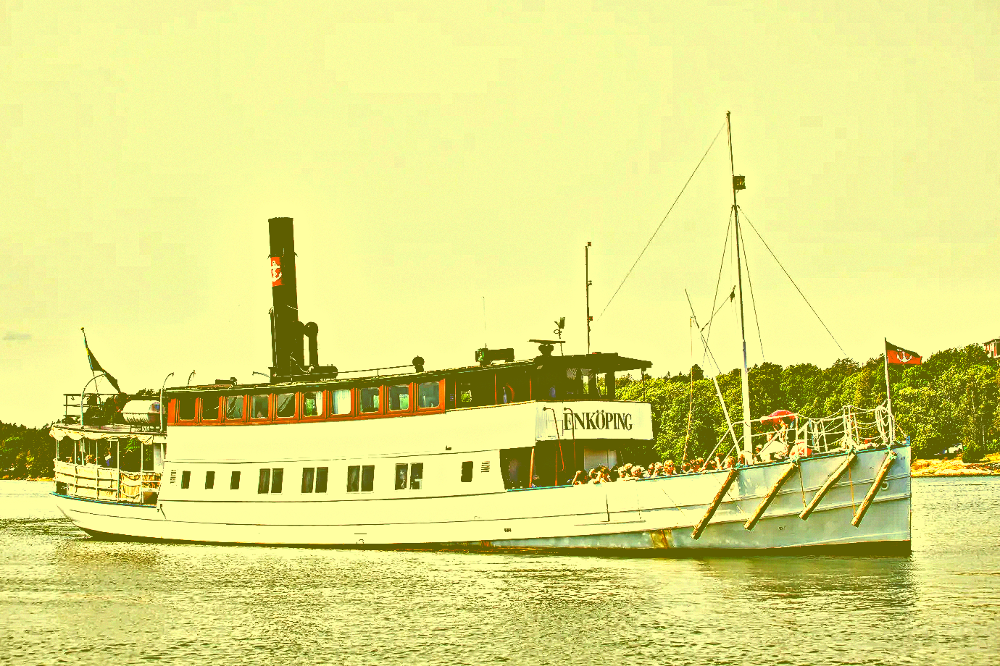

В Швеции спа-туризм начал развиваться с XVII века. На тот момент только привилегированный класс мог позволить себе отдых и путешествия по Европе. Однако, в конце XIX и начале XX века туризм стал доступным для среднего класса. В этот момент начали появляться нишевые туристические направления, такие как альпийские курорты и морские вояжи.

Туризм в Европе начал набирать обороты, отчасти из-за технологических улучшений в сфере транспорта, отчасти вследствие изменений в досуге и увеличении доходов. Подъем железной дороги стал одним из самых важных факторов роста массового туризма. Незадолго до конца XIX века железнодорожное и пароходное сообщение уже было неплохо налажено по всей Европе и рассматривалось, как средство транспорта, которое могло перевозить большое количество пассажиров относительно быстрым и недорогим способом.

M/S Enköping был построен в 1868 году и на сегодняшний день является самым старым все еще действующим пассажирским судном в мире.

С начала XX века количество рабочих часов для европейцев уменьшилось и у них появился установленный законом отпуск. В то же время, с окончанием мировой войны и возрастающей индустриализацией выросли и доходы, что имело большое значение для возникновения потребности путешествовать в свободное время.

В соответствии с организационно-производственной структурой индустриализма, досуг в Швеции стал приобретать все большую актуальность по мере развития регулируемого разделения между рабочим и свободным временем.

В 1938 году в Швеции был принят первый Закон об отпуске (Semesterlagen).  
Он дал право всем работникам иметь две недели отпуска. Со временем, в календаре начало появляться все больше официальных праздников и количество свободного времени увеличивалось. Индустриализация стимулировала рост доходов и населения; в результате чего, число тех, кто имел возможность путешествовать, выросло. Теперь не только высший класс, но и средний, мог позволить себе отправиться в ближние и дальние страны за впечатлениями.

> *Отпуск и повседневная жизнь - взаимоисключают друг-друга. В то время это было нечто совершенно неслыханное.*

В 50-х годах автомобиль становиться самым важным средством передвижения в Швеции, а стремительное развитие коммерческой авиации в послевоенный период оказывает чрезвычайное влияние на туризм и является фактором роста популярности чартерных рейсов в 60-х. Путешествовать становиться возможно даже на короткий срок, например на выходные. Характерно то, что такая поездка не заменяет ежегодный отпуск; пункт назначения обычно находится в пределах собственной страны; и часто она осуществляется спонтанным решением.

Таким образом, индустриализация привела к разделению между рабочим временем и отдыхом, а экономические и технологические разработки сделали путешествия доступными для большего числа людей.
