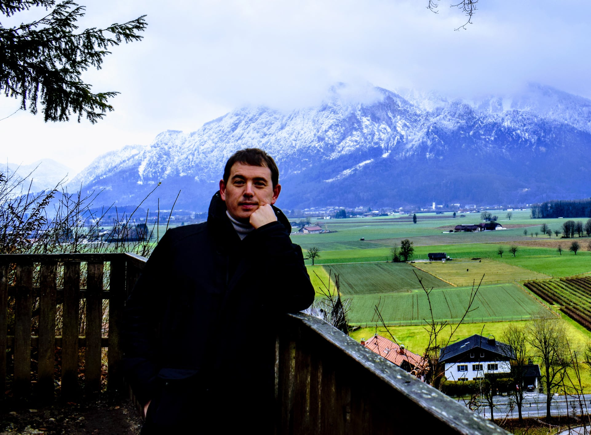

Вот и промчался, столь стремительно, этот безумный год. Последняя остановка и поезд отправляется в депо. Уносит с собой тени прошлого. Его провожать будут точно не так, как встречали, когда его предшественник растаял в дыму фейерверков.

Стоит ли говорить, что он выдался щедрым на события. Потрясающий год. Невероятный, как свора клоунов в парламенте цивилизованного государства и неожиданный, как удар серпом по молоту.

Я вижу его в двух контекстах, несомненно взаимо-детерминированных: «за окном» и «из окна».

В первом случае — это период полный драматических событий. Он начался, как помню, со сбитого самолета. Затем весь мир погрузился в глобальную эпидемию. До сих пор трясет. На фоне неопределенности тысячи людей вышли на массовые протесты, которые быстро переросли в анархическое безумие в виде мародерства и вандализма. Со временем все утихло, как небывало, а зараза унесла с собой жизни 1,8 млн человек. Но просвет уже близко и выглядит он как пара инъекций наспех сварганеной вакцины.

Как бы там ни было, похоже, больше всего хлопот доставила людям не сама хворь, а беспрецедентные меры, принятые большинством стран для борьбы с распространением вируса. Повсюду были слышны стоны и жалобы на эту сложную ситуацию. «Из-за проклятого карантина мы с друзьями были вынуждены отменить наш ежегодный тур на Мальорку», «Мой любимый ресторан закрыли, что за черт! Теперь приходиться заказывать еду домой», «Ночные клубы не работают, как теперь жить?». И все в таком духе. Истинная трагедия.

У меня тоже сорвались планы и я претерпел некоторые неудобства из-за ограничений. Но едва ли мне стоит жаловаться — в конце концов холодильник не пустой, а из крана течет вода самого высокого качества. Тем временем, по данным ООН и ВОЗ, более 2 миллиардов человек не имеют доступа к чистой питьевой воде, около 4 млрд не имеют безопасных средств санитарии. Еще есть те, кто страдает от голода, подвергается регулярному насилию или неизлечимо болен. И что-то мне подсказывает, что это совсем не те люди, которые выливают в соцсети свои страдальческие сообщения о том, какими чудовищными выдались эти 366 дней и вероятно не те, кто радостно публикует воодушевляющие видео, где ликующая толпа кувалдами разбивает гипсовую эмблему 2020.

Смею надеяться, что не у кого теперь нет иллюзий по поводу пандемии. Припоминаю, еще не так давно, лента искрилась постами типа: «коронавирус — это политика». В июле я был в Киеве и меня несколько удивило число индивидуумов (к счастью, не из круга моих прилежных знакомых) дезинформированных самой нелепой ересью, которую мне было бы даже сложно измыслить. Воистину, нет предела человеческому невежеству! Кто-то, разумеется, на этом заработал, но не несчастные, с болтающимися на подбородках масками, и их ближайшие родственники и коллеги.

Ну, а что до меня, то я в этом году мечтал чипироваться, однако к большому сожалению, коварные планы господина Гейтса и его приспешников, заседающих в закулисье мирового правительства, были скомпрометированы. Компания с 5G провалилась. Я, разумеется, огорчился, но все же решил, что попробую вакцинацию, а вдруг. Однако, по этой причине, меня, как ни прискорбно, изгнали из союза антипрививочников и лишили всех привилегий.

Ну, а если серьезно, то «из окна» год кажется намного лучше. Да, пришлось изменить планы, но всегда можно найти в этом какой-то плюс. Личные проекты, которые я пообещал себе реализовать в этом году либо исполнены, либо начаты и не отложены в долгий ящик, что для такого парня как я, с мировоззрением по D&D хаотичный нейтральный, весьма неплохо. У меня родилась очаровательная дочь. Появились новые друзья. И конечно же, я в своем познании настолько преисполнился, что как будто бы уже сто триллионов миллиардов лет проживаю на триллионах и триллионах таких же планет! Мне уже этот мир абсолютно понятен, и я здесь ищу только одного: покоя, умиротворения и гармонии от слияния с бесконечно вечным! :-)

Берегите себя, здоровья вам и удачи, друзья мои! И помните — All Lives Matter.

С наступающим Новым Годом!
