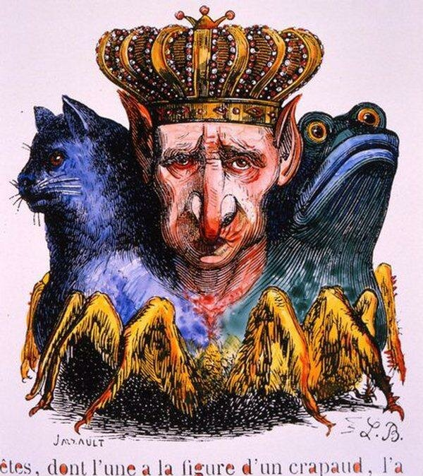
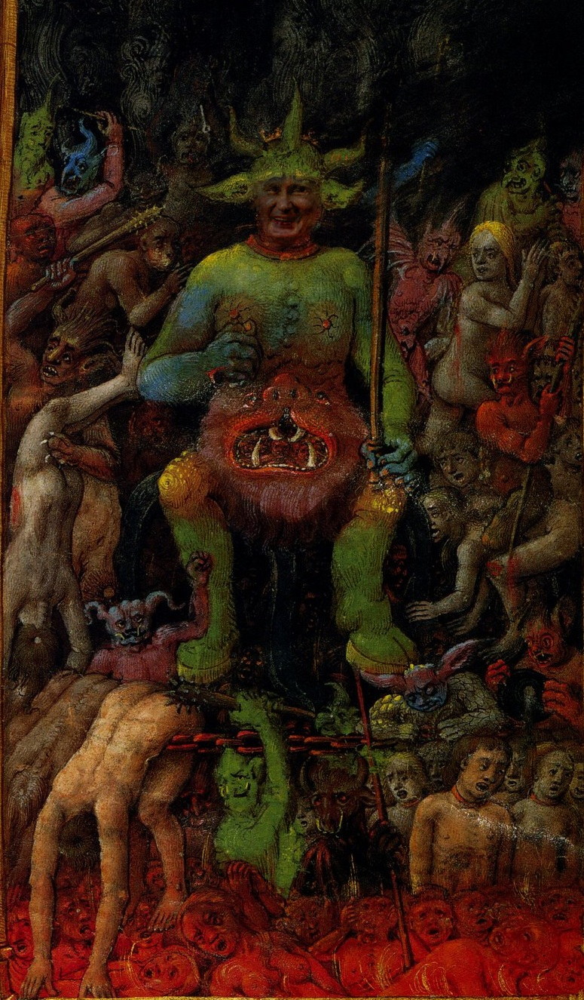

Баал — король демонов, правящий на востоке и управляющий более чем 66 легионами адских духов. Именно таков есть нынешний царь России — воплощенная эманация омерзительного и кровожадного демиурга, изрыгающего инфернальную злобу и ненависть. Его тлетворные легионы служат ему добровольно, исполняя все известные им изуверства и казни.

В этой войне нейтралитет невозможен. Есть сторона добра и сторона зла. Нет оправдания тем, кто должен говорить, но молчит и тем, кто мог противостоять, но ничего не сделал. Трусливые псевдожурналисты, малодушный Запад, жертвы пропаганды — все виноваты.

Сложно описать этот тяжелый компот отвращения и презрения ко всем причастным. Да и не нужно. Имеющий уши, да услышит!

Однажды, демоны, призванные истязать грешников, сойдут со средневековых гравюр и доберутся до каждого, кто участвовал в этом зверстве. А пока же, воины добра будут решительно отправлять всю эту нечисть в преисподнюю, где им уготован радушный прием.

«Ибо огрубело сердце народа сего, и ушами с трудом слышат, и очи свои сомкнули, да не узрят очами, и не услышат ушами, и не уразумеют сердцем, и не обратятся, чтобы Я исцелил их»  
Исаия

