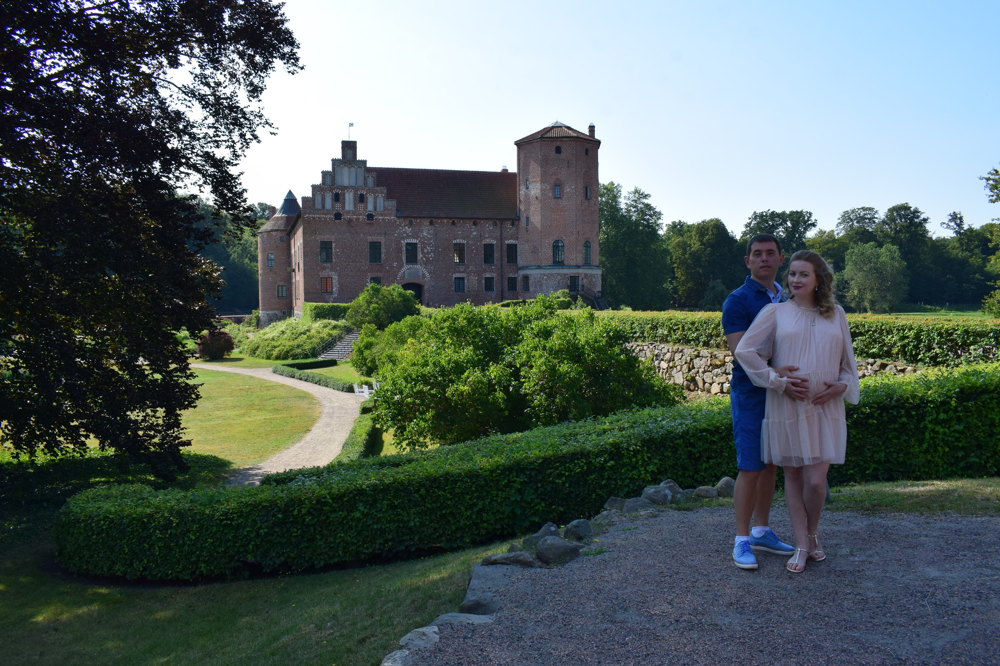
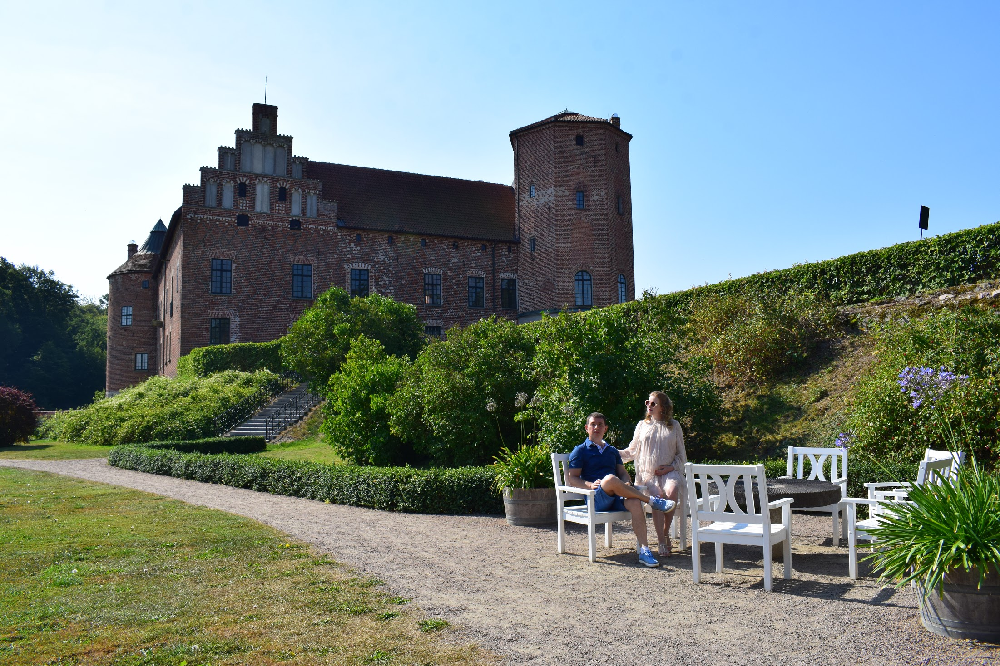
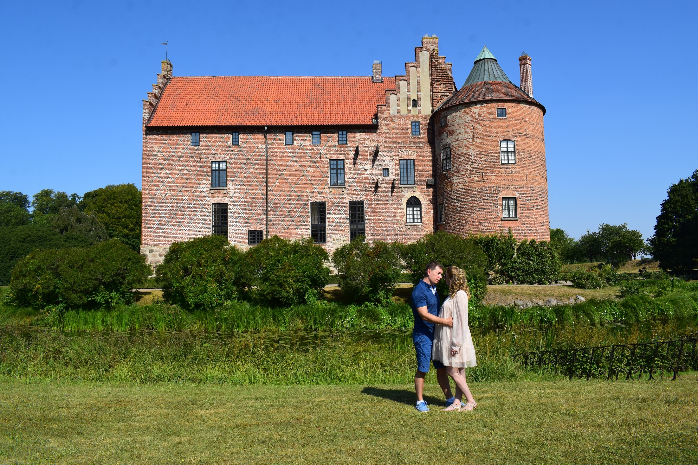
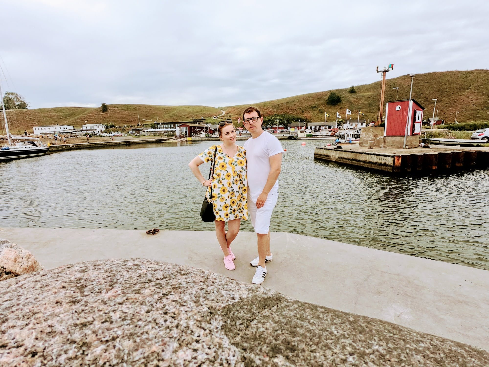

1-го октября 2020-го года в 23:55 по центральноевропейскому летнему времени у нас родилась дочь - **Элис София Блоцкая**.

В час ее рождения на небе призрачно сияла большая урожайная луна. Ночь была свободна от ветров, прохладный воздух только слегка коснулся пустынных городских улиц. Все случилось так, как и должно. Моя дорогая жена стойко преодолела все тяготы процесса рождения и на свет появилась девочка, весом чуть более трех килограмм двести грамм и ростом 49 сантиметров. Я же, как и положено отцу, прошел с ней весь путь, от начала и до конца; затем, кто-то вручил мне ножницы и я уверенно перерезал пуповину, таким образом утвердив на этом свете новую жизнь. Это было поистине невероятно - я стал свидетелем чуда рождения!

Пройдя через муки, мать устанавливает особую связь со своим ребенком. А отец, стоит и смотрит, не в состоянии постигнуть произошедшее. Этот крохотный человечек - моя дочь, кровь от крови. Прелестна, как улыбка ангела. Со мной ли все это?

Немного погодя, и все последующее время, чувство моего с ней родства, которое сложно описать, становиться все сильнее. Так образуется наша неразрывная связь. Любовь и забота.

На этом у меня, пожалуй, все. Боюсь, пора собираться с духом и идти менять подгузники 🙃 ведь мы теперь родители!

