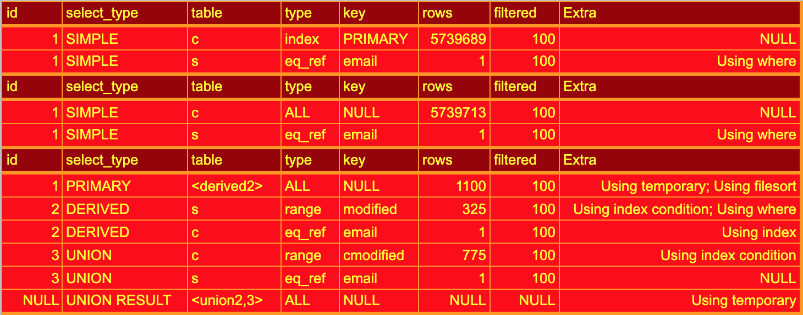

Недавно я столкнулся с проблемой медленного выполнения довольно простого запроса в MySQL. Анализ и поиск оптимизации привел меня к неожиданному решению. Верно, где-то я пропустил этот урок. Тем не менее, вот он ответ, прямо по тексту.  
**\**

**Проблема**: запрос выполняется чрезвычайно медленно, несмотря на кажущуюся иллюзорность оптимизации на индексах.

**Решение**: как говаривал старина Эйнштейн, правильно сформулированный вопрос - есть большая часть решения проблемы.

**Объединение двух таблиц с условием по индексным полям в связке с оператором** **OR**

Рассмотрим следующий запрос:

    select c.id, s.gender from customer c
     left join subscription s on s.email = c.email
     where s.modified between '2020-04-30 15:00:00' and '2020-04-30 16:00:00'
     or c.modified between '2020-04-30 15:00:00' and '2020-04-30 16:00:00'
     group by c.id
     order by c.id DESC;

фрагмент 1

С точки зрения декларативного стиля такой запрос выглядит весьма логично, нас интересуют данные из двух таблиц за один и тот же промежуток времени. Сразу хочу сказать, что здесь мы имеем индексы по полям **email**, **modified** для обеих таблиц.

Казалось бы, отобрал строки по индексу **modified** из обеих таблиц и свел по ключу (eq_ref). Делов-то! Но, увы, это так не работает. Выполняется полное сканирование одной таблицы для каждой комбинации строк из другой (ALL). Почему? Хороший вопрос.

В индексах нет никакого смысла, поскольку для того, чтобы соединить строки нужно проделать полное сканирование. Нельзя отобрать данные по какому-либо из индексов из одной таблицы и соединить с другой - так как вы рискуете потерять данные из второй таблицы (и вообще это совсем меняет условие).

Как же быть? С помощью потусторонних сил я вызвал в памяти образ Декарта и воспроизвел мне явленное - оператор **UNION.**

Его недостаток в том, что он проделывает дополнительную работу по устранению дубликатов (к счастью только на результирующих строках), однако он позволяет оптимизатору запросов использовать индексы в обеих таблицах.

Вот как стал выглядеть оптимизированный запрос:

    select id, gender from (
       select c.id, s.gender from customer c
       left join subscription s on s.email = c.email
       where s.modified between '2020-04-30 15:00:00' and '2020-04-30 16:00:00'
       union
       select c.id, s.gender from customer c
       left join subscription s on s.email = c.email
       where c.modified between '2020-04-30 15:00:00' and '2020-04-30') as t
     group by t.id
     order by t.id DESC;

фрагмент 2

Несколько многословно, зато скорость впечатляющая! При таком подходе происходит отбор данных по индексу сначала из одной соединенной таблицы, а затем к результату добавляются отобранные по индексу строки из другой соединенной таблицы. И это работает гораздо быстрее.

Ниже приведены результаты анализа запроса (EXPLAIN). Сверху вниз: неоптимизированный запрос из *фрагмента 1*; тот же запрос без **group by** и **order by** и оптимизированный запрос из *фрагмента 2.*

**Бонус:**

Запрос без **group by** и **order by** дает нам более ясное представление о методике выполнения запроса, а именно - показывает, что нет никакого индекса и нужно прочесывать всю таблицу.

Больше всего в глаза бросается тип соединения и количество строк. Это важнейшие показатели, на которые прежде всего обращают внимание при анализе эффективности запроса.

Ссылки:

[Query Performance Optimization](https://www.oreilly.com/library/view/high-performance-mysql/9780596101718/ch04.html)

[EXPLAIN Output Format](https://dev.mysql.com/doc/refman/8.0/en/explain-output.html#jointype_eq_ref)

[Stackoverflow - Union vs OR](https://stackoverflow.com/questions/13750475/sql-performance-union-vs-or)\
