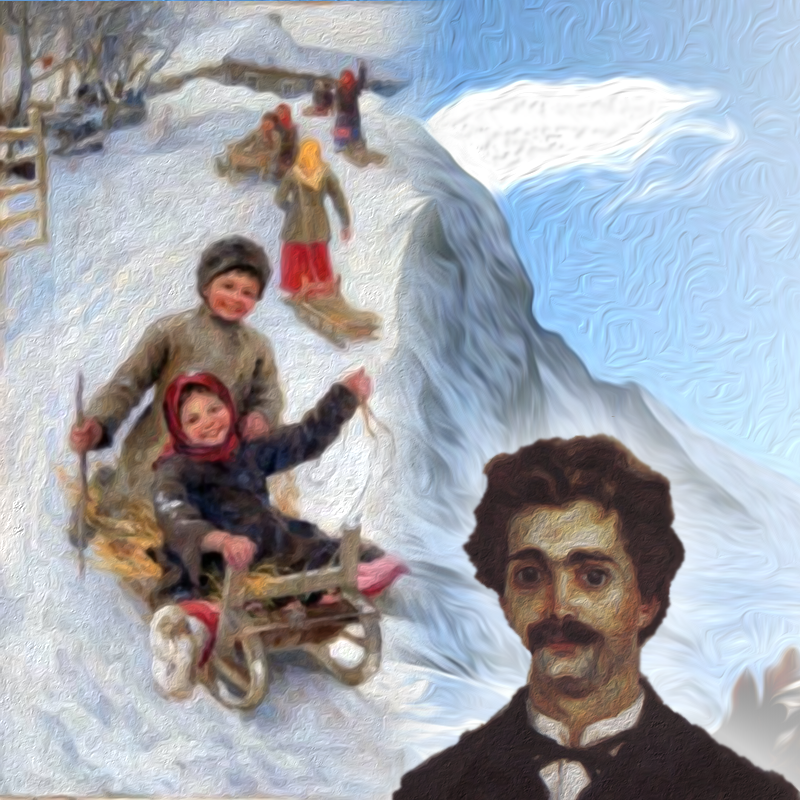

Однажды мы с Колей разбирали старый шкаф в подвале на Пушкинской. Среди кипы бумаг и старых газет мне на глаза попалась старая тетрадка с причудливым рисунком: деревья, чьи корни сплетались под поверхностью земли. Я положил ее на стол, чтобы посмотреть позже и вечером того же дня, когда все ушли по домам, оставив меня на дежурстве, она снова привлекала мое внимание. Стряхнув пыль с обложки я открыл тетрадь и тут же маленькая карточка выпала на пол. На ней был изображен святой Бонифаций держащий в руках книгу пронзенную мечом. Обратная сторона содержала неровно начертанную кем-то надпись: mea culpa.

Первые несколько страниц были грубо вырваны, остались лишь обрывки слов. Следом шли пустые листы и я уж было огорчился, что ничего не найду, но, пролистав немного, я увидел текст. Строки были выведены изумительным почерком и я предположил, что писала женщина. Но чем больше я читал, тем сильнее мне казалось, что это мысли подростка.

“Случалось, выбегали из заколоченных подъездов прямо на свежий снег. Тут тебе и раздолье, и лес поблизу. Так хотелось дышать; до чего наскучили эти тонущие в мареве городского ландшафта дома и тесно обставленные квартиры с темными длинными коридорами, и пыльные занавески на дряхлых окнах, и старые ботинки в шкапу, а еще портрет с непроницаемым взглядом на стене.

А тут, во дворах и на околицах, в самой гуще пролетарского эскапизма, всякие игры и забавы свободно изобретались и находили свое место.

Край у нас богатый! В основном - на леса; и традиции у нас свои - лесные. Из-за того мы, будто изолированы от остального мира. Но чем богаты - тем и рады. Хотя всякий год к нам какой-нибудь чиновник из столицы все же заглянет: устроим ему пышную встречу, как полагается, а затем припроводим, с чувством исполненного долга и облегчения. Кроме того, по закону, мы празднуем старые и новые государственные торжества. Никто их толком не понимает, но главы города тщательно следят за исполнением каждого. Есть же и другие традиции - народные, глубоко укоренившиеся в наших сердцах, ибо они нам понятны и отражают нашу суть. Все эти обычаи, конечно же, считаются нежелательными, а потому незаконными. Но в наш тихий край так мало кто заглядывает, что управитель, по-обыкновению, против наших особых традиций редко выступает и часто закрывает глаза на наши шалости. Впрочем, случается, что те, кто в мундирах, нас помнут, арестуют и отправят по домам. А наверх доносят, что, дескать, работы с нарушителями правопорядка проведены, как и запланировано высшим руководством. Генерального канцлера же народ не шибко жалует, но по какой-то давней причине считает его своим или, лучше сказать, данным. И действительно, если поразмыслить о других правителях, то пусть лучше будет этот. А то вон какие деспоты восседают! Взять хоть, к примеру, наших соседей. Так и живем, с тем, что есть.

Первая народная забава, о которой я хочу рассказать, снискала популярность еще во времена наших дедов. Зимой шли в лес неподалеку (уж не знаю как наши отцы, а мы всегда берем с собой электросани) и играли там целый день, до самых сумерек, а возвращаясь обратно, уставшие и довольные, пели излюбленные старые песни пока не подходили к перекрестку, что у ворот в город. Тут, не редко, у кого хватало сил, подолгу стояли, переваливаясь с ноги на ногу, обсуждали игру, смеялись. Звезды к тому времени тускнели в тумане уличных фонарей, и самые стойкие, чаще всего какие-нибудь юноши, распрощавшись, бежали домой. Кто-то, уже не вспомнить, кто именно, даже смастерил бревенчатый навес у перекрестка, чтобы, когда в город зайдут снега, было где спрятаться.

В игре правила простые: один, выбранный случаем, взбирается на сани и именуется Лаврентием, пока другие разбредаются по лесу, чтобы найти укромные места и затаится. Лес у нас дремучий, в нем много старых больших деревьев и массивных пней. Есть овраги, лощины, ручьи и болота, которые застывают зимой. Для каждого из нас пойти в лес - обычное дело. Вот к примеру: станет одному грустно или, положим, мучается другой сомнениями, или третьему нужно принять важное решение. Куда пойдут? Ну разумеется ответ очевиден! Потому и троп у нас всяких так много.

Сядет, значит, Лаврентий на сани и по этим тропам ухабистым мчит. А сам присматривается к каждой тени, к каждому движению куста или ветки. Потому, что задача его - не пропустить внезапную атаку затаившихся партизан. В руках у него ивовый или какой-другой прут, которым он может отражать их внезапные нападения. Если кому удастся неожиданно выпрыгнуть из сугроба или выскочить из-за старого пня, схватить при этом Лаврентия и сбросить с саней, то он занимает его почетное место. А ежели он попадется, то неизменно получит прутом и займет место в авангарде, таким образом став полицаем, чья задача бежать перед санями и выискивать остальных диссидентов, помогая Лаврентию вершить его волю. Чемпионом становиться тот Лаврентий, который пленил всех партизан.

Летом же, когда солнце наконец достаточно прогревает эти земли, чтобы цветы наполнились нектаром, а улья медом, когда дни становятся длинными, как лесные тропы - другая затея служит нам увеселением на протяжении многих благодатных вечеров аж до самого сезона сбора урожаев. К востоку от города есть место именуемое “Белый лес”. Название такое, по-видимому, произошло от обширных березовых рощ преобладающих в тех местах. Существуют правда и другие версии, вплоть до нелепых, где слово “белый” ассоциируют то с грибами, то с белогвардейцами, а порой, даже с каким-то рыцарским орденом. Как бы там ни было, в наши дни Белый лес примечательный тем, что однажды группа скаутов наткнулась на тело священника, лежащее под деревом на буковой поляне. Соорудив носилки, они отнесли его в ближайшую деревню, но, уже на подступах к дому лекаря, святой отец неожиданно пришел в себя, испустив истошный вопль, что переполошил местных жителей. Кто в деревне постарше, если спросить, хорошо помнят тот день, будто сам Вельзевул, визжа и чертыхаясь, разорвал скорлупу своей оболочки.

Священник опомнился через пару минут, и позже, лекари не обнаружили у него никакого недуга. Его отправили обратно, в обитель соседней епархии, где он служил. О том, как он попал в лес и что там делал, он так и не смог разборчиво рассказать. Выяснилось, однако, что несколько дней назад его хватились монахи, напуганные внезапным исчезновением немолодого игумена. Говорили, что в конечном счете он покинул монастырь и ушел жить в леса. Кто же знает, люди толкуют всякое.

Кроме того, Белый лес известен своей необычной достопримечательностью - “Красной горкой” - высоким и крутым выступом гранитной породы с одной стороны и пологим склоном с другой, окруженной дубравами и березняком. Каким образом этот исполинский кусок гранита вырвался из земли прямо посреди ровного густого леса - задача для геологов, а мы же, с присущей нам изобретательностью, чего только не напридумывали.

Самыми любимыми развлечениями летом, безусловно, являются скалолазание и “низложение ленивого Лукаша”. С первым, нам очень, надо сказать, повезло, ибо в нашем крае нет гор, да и мало кто их вообще видел. Так что, к нам часто приезжают из соседних городов и деревень, чтобы вооружившись снаряжением, почувствовать себя покорителями вершин. Ну, а нашим ребятам каждый камушек знаком и оттого лазаем мы, как заправские шерпы.

Игра же состоит в следующем: один, называемый Лукашем, взбирается на стену и, усевшись на специальный выступ, смотрит вниз на остальных. С того места, откуда он глядит, не видно, что происходит у самого подножья и на стене, зато хорошо просматривается поляна перед горкой. На ней остальные разыгрывают всякого рода спектакли, чтобы развлечь и, в тоже время, отвлечь Лукаша. Пока одни участники играют роли, кто-то из труппы становиться партизаном и залазит на стену. В один момент времени только одному дозволено карабкаться вверх. Это не мешает ему зацепиться за уступ и притаиться, пока кто-то другой лезет по стене. На стену могут вылезть хоть сколько угодно партизан, но карабкаться одновременно не разрешено. Лукаш же, должен быть внимательным и неторопливым. Когда он точно понимает, что кто-то видимо на стене, он громко кричит его имя, и если тот и вправду там, то он снимается и выбывает. А если названный находиться у подножия, то он выходит на поляну, свидетельствуя себя, и тем самым Лукаш становиться ленивым. Это значит, что в течении ровно одной минуты он не смеет произносить имен, а вся труппа мигрирует к подножию. В то же время, партизаны по очереди, или кто-то один, спешно карабкаются к вершине. Спустя минуту артисты возвращаются на места и продолжают игру.

Лукашу нужно быть осторожным: вылезти на скалу - дело нескольких минут. Одна ошибка и кто-то может показаться на вершине. Артисты меняются, чтобы Лукаш не понял, кто лезет по стене. Ну, а партизан, добравшийся до вершины, занимает место Лукаша.
