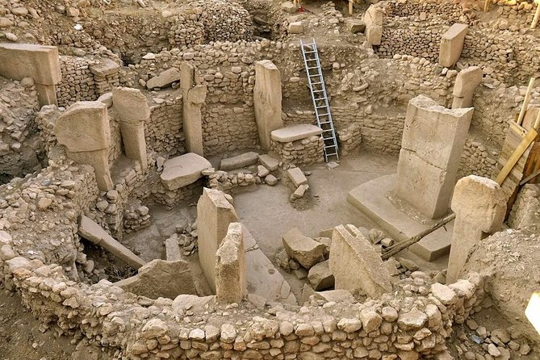
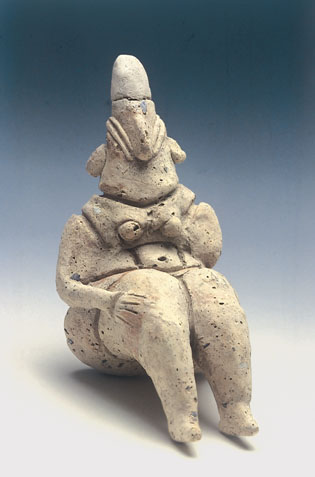
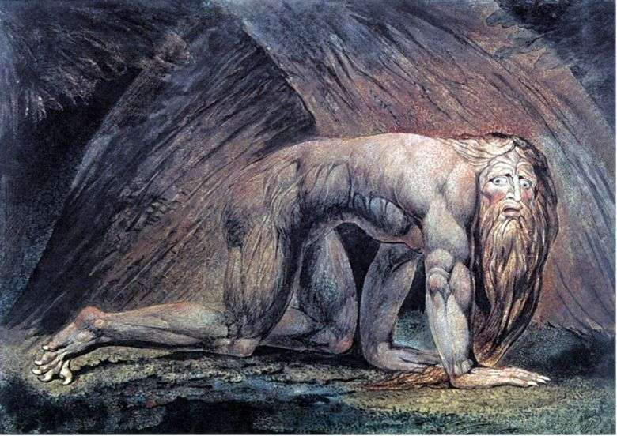
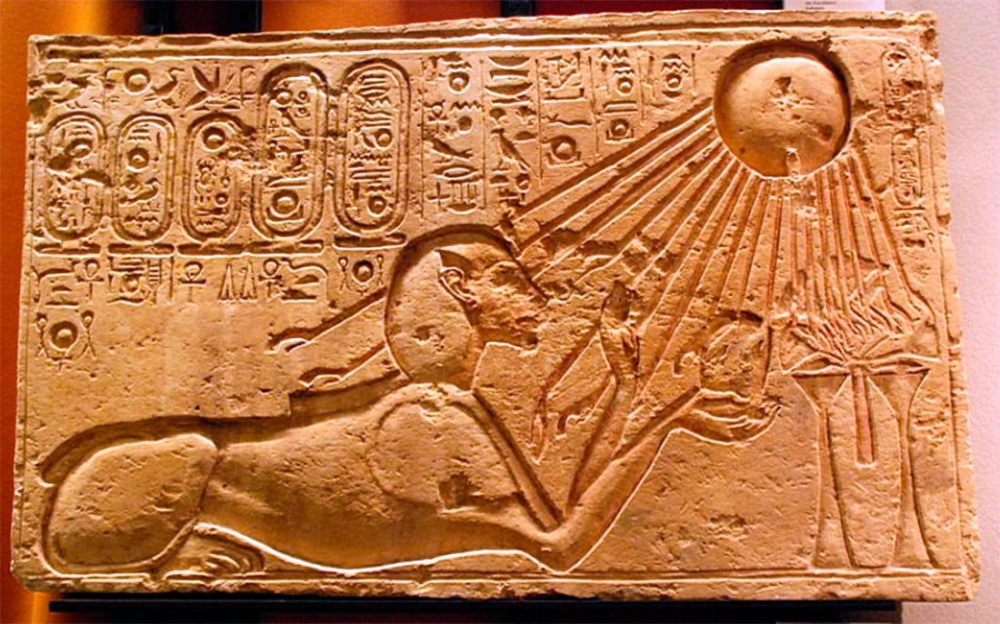

*Это первая часть из цикла «Размышления о современной религии».\*

> 

*В данной серии статей я хочу изложить некоторую интерпретацию моих теологических исследований и воззрений, навеянных непрерывным поиском ответов на возникающие у меня в процессе размышлений вопросы. По большей части, это изложение уже известного материала, развернутого под особым углом, но в некоторой мере, это так же попытка выразить собственные умозаключения. Подобные изыскания, несомненно, требуют как большого количества времени так и особого внимания к деталям, а значит — огромных умственных затрат. Поэтому прошу не судить меня строго за возможную сухость и непоследовательность.*

> 

> 

> 

### Преамбула

> 

> 

Прежде чем начать повествование, необходимо дать точное, связующее определение предмету нашего краткого, но пристального разбирательства. В противном случае, мы рискуем быть сбитыми с толку вытекающими друг из друга концепциями, которые, при некорректном толковании, коварно создают устойчивую сингулярность, как две прямые вставшие в одну линию в смещенной перспективе.

> 

> 

И так, монотеизм — вера в единого бога.

> 

Мы должны принять этот тезис без каких-либо оговорок: **существует только один бог и нет другого.** Это принципиальное воззрение будет лейтмотивом всей цепочки наших рассуждений.

> 

> 

### Единобожие

> 

> 

Сегодня, идея монотеизма представляет собою фундаментальный постулат на котором зиждется иудаизм, христианство и ислам — все авраамические религии. Однако, столь прочный сплав взаимоотношений между Творцом и его творением закалился не в одно мгновение. Доктрине требовалось время и место, чтобы прорасти и укрепиться в сознании верующих, став доминирующей концепцией в современных религиях.

> 

> 

### Храм

> 

> 

*В древности люди нашли изощренный способ объяснить различные явления природы — так появились боги. Эти высшие формы были суровы и требовали поклонения — так возникла религия.*

На развалинах храма в Гебекле-Тепе

> 

На просторах современной Турции, близ древнего города Шанлыурфа, благодаря кропотливой работе археологов был вскрыт пласт грунта на подозрительного вида холме. Раскопки обнажили каменный круг с установленными в нем массивными Т-образными колоннами, на которых сохранились гротескные барельефы. Эти причудливые изображения были искусно вырезаны в камне с помощью примитивного молотка и такого же незатейливого зубила. По какой-то неведомой причине, группа охотников-собирателей, блуждающих по этим плодородным землям в IX тысячелетии до н. э. решила сплотиться для грандиозного строительства. Сегодня, этот некогда засыпанный землей, древнейший мегалитический храмовый комплекс, известен как Гёбекли-Тепе.

> 

Его создатели, эти прогрессивные новаторы и инженеры, обработали, приволокли и установили вырезанные из известняка тяжелейшие глыбы на специально отобранное место, таким образом возведя самый древний в мире храм, поражающий своим масштабом и замыслом. Этот удивительный образчик первобытного зодчества был местом паломничества, а также центром развития культуры и зарождения земледелия.

> 

Примечательно, что исполненные в камне образы свидетельствуют о наличии высокого художественного вкуса у их создателей. Но главное — они представляют собой иконы, преисполненные религиозного смысла.

> 

Древние строители, по мнению израильских исследователей, имели четкий план возведения всего комплекса. И это поразительно! Могут ли быть сомнения в том, что только некая религиозная доктрина могла сдвинуть эти каменные глыбы с места? А как иначе сподвигнуть множество людей совместно работать над беспрецедентным, невиданным для того времени проектом, не сулящим очевидной выгоды?

> 

Впоследствии, эти убежденные пилигримы, древние каменщики и скульпторы, превратились в оседлую группу и занялись сельским хозяйством. Так, вокруг храма, возникло, возможно, самое первое в истории поселение людей.

> 

В VIII тысячелетии до н. э. комплекс был похоронен под грудой земли и предан забвению. Он исчез на многие века, так же таинственно, как и появился.

> 

> 

### Культ

> 

> 

На протяжении истории, храмы были местом притяжения. Вокруг них возникали поселения, города, цивилизации. Религия давала не только ответы на вопросы, но также являлась своего рода утешением в суровом древнем мире. Она открывала двери в чудесный мир и дарила верующему надежду, что он может повлиять на то, на что повлиять было невозможно. Например на урожай или жизнь после смерти. Культ плодородия, как и культ загробной жизни, всегда играл особую роль в религиях. Идея, что на той стороне мы продолжим существование — весьма притягательна, не говоря уже о том, что с помощью ритуалов и подношений можно умалить засуху.

Глиняная фигурка богини-матери, Ярмукская культура, Шаар ха-Голан

Концепция божества, как некой неизменной сущности, хорошо прослеживается в культе богини-матери. На севере Израиля было найдено множество однотипных статуэток периода керамического неолита с весьма характерными чертами. По всей видимости, местное племя имело четкое представление о том, как выглядит их божество. Люди наделяли его определенными качествами и сформировали некую концепцию поклонения. Мы можем говорить о том, что там имело место быть устойчивое понятие бога. Тем не менее этим верованиям до монотеизма было еще далеко.

> 

> 

Первый устойчивый пантеон богов возник в шумерской цивилизации. Он стал прародителем других религий. Люди поклонялись высшим силам и возводили храмы вокруг которых образовались города. Все это казалось осмысленным и даже необходимым. Жрецы процветали, занимая верхнюю ступень иерархии в обществе. И не мудрено, в конце концов они осуществляли связь с богами.

> 

Доподлинно неизвестно, когда именно люди догадались, что религию можно весьма неплохо использовать в своих целях. На ней можно разбогатеть, получить власть или сделать карьеру. Но уже у шумеров, жрецы охотно пользовались привилегиями и стали накапливать существующие блага.

> 

Стратегия жреца проста: если бог услышал молитвы и обрушил долгожданный дождь на посевы — это благодаря старательной его работе; если возникла засуха — вероятно подношения были недостаточными.

> 

В конце концов, всегда можно сменить одного бога на другого, более могущественного, щедрого или милосердного. Так, старые боги предавались забвению, а новые торжествовали.

> 

> 

### Яхве и монотеизм

> 

> 

Подобное положение вещей существовало и на Ближнем Востоке. Израильтяне, как известно, почитали ханаанских богов, многие из которых были выходцами из Вавилона. Этот пантеон, в свою очередь, произошел от аккадского, являясь смесью шумерских и западносемитских верований. В результате завоеваний происходили всевозможные культурные и религиозные адаптации и метаморфозы. На этом пути, одни боги уступали место другим в иерархии. В разных регионах и городах жрецы могли выбирать богов и богинь по вкусу, ассортимент был достаточно обширным.

> 

> 

Израильтяне избрали своим верховным богом Яхве. Его происхождение до сих пор является предметом дискуссий. По одной версии — Яхве был богом ханаанского пантеона, который стал покровителем израильтян, то есть был перенят вместе с другими богами после завоевания. Другая теория утверждает, что он был известен еще в незапамятные времена и заново открыт Моисею на горе Синай. В третьей версии высказывается известное мнение о том, что Яхве не был известен до Исхода и был представлен народу Израиля Моисеем, как совершенно новый бог. Есть еще версии о том, что прообраз был импортирован из южных земель или что Яхве был богом кузницы и покровителем металлургов в Бронзовом веке.

> 

> 

Как бы там ни было, нам известно, что Яхве не был единственным — поклонение израильтян другим божествам засвидетельствовано, как в самой Библии, с ее критикой многобожия, так и археологией. Но именно этому богу было суждено определить судьбу монотеизма.

> 

Уильям Блейк «Навуходоносор»

> 

В VI в. до н. э. армия вавилонского царя Навуходоносора II взяла Иерусалим. Они сожгли город и уничтожили храм Соломона, построенный для Яхве. Уцелевшие жители были насильно выдворены в Вавилон. Иудейское государство пало.

> 

Этот момент в истории известен как Вавилонское пленение. В течении 70 лет израильтяне жили в древнем царстве, образуя родовые группы. Казалось, они должны были отречься от своего бога, который допустил их прискорбную учать и принять другого — победоносного. Однако, покоренные и угнетенные они напротив — укрепились в своей вере. Их рассуждения были просты: вавилонский бог одержал победу лишь потому, что Яхве использовал его в качестве своего инструмента, дабы наказать свой народ за отступничество от истинной веры. Значит Его воля — наивысшая. Такой, довольно экстравагантный для того времени подход, имел решающее значение для становления монотеизма.

> 

Вернувшись из Вавилона, еврейский народ начал строительство нового храма, а понятие единственного бога устойчиво прокладывало себе путь в умах верующих. Каноны были пересмотрены.

> 

Успех этой идеи заключался в том, что один бог вместо множества обладал неограниченной силой и могуществом. Если остальных богов не существует — то нет никакой конкуренции среди высших сил. Один бог — один источник истины. Поклоняясь ему можно было не сомневаться в том, что молитвы будут направлены куда требуется. И кроме того, такая доктрина, в долгосрочной перспективе гарантировала себе прочное будущее.

> 

> 

### Генотеизм

> 

> 

В книге Моисея сказано: «Да не будет у тебя других богов перед лицом Моим». Звучит достаточно радикально, но при этом никак не отрицает существование других богов. Эта доктрина называется генотеизмом. Десять заповедей и большая часть Пятикнижия выражают именно такие взгляды, которые до Вавилонского пленения, как считается, преобладали среди израильтян.

> 

Однако, еще до разрушения первого храма, пророк, по имени Исайя, достаточно ясно выразил концепцию монотеизма, которая окажется важнейшим постулатом пересмотренной доктрины веры в единого бога.

> 

> 

*«Я Господь, и нет иного; нет Бога кроме Меня»*

> 

Исаия 45:5

> 

> 

> 

### Предшественники

> 

> 

Монотеизм, как устоявшийся религиозный продукт и основа верований был успешно реализован евреями. Но они были не первыми, кому пришлась по вкусу эта простая идея.

> 

В XIV веке до н.э. в Египте существовал хорошо организованный пантеон. Жрецы прилежно исполняли свои ритуалы, люди безропотно поклонялись множеству богов. Однако, наперекор всему, что было создано за долгие столетия, фараон Аменхотеп IV решил упразднить многобожие в пользу одного единственного бога Солнца, Атона. В честь этого он взял себе имя Эхнатон. Мы не знаем точно, что стало причиной таких радикальных религиозный реформирований. Тем не менее, эти экстраординарные изменения просуществовали недолго. После смерти фараона, отвергнутые боги поспешно вернулись на свои места.

Эхнатон в образе сфинкса поклоняется Атону. Музей Кестнера в Ганновере

> 

> 

Еще одной попыткой установить монотеизм было учение Заратустры, который провозгласил Ахурамазда единым богом. Но, спустя десятилетия после смерти пророка культ многобожия не преминул вернуться.

> 

> 

Очевидно, что для того, чтобы такая радикальная идея созрела должно было случиться что-то выдающееся, а чтобы она прижилась и расцвела требовалось время.

> 

> 

> 

### Распространение монотеизма

> 

> 

Иудаизм стал первой мировой монотеистической религией. Однако для распространения этой блестящей идеи потребовалась другая, основанная на нем, религия — христианство.

> 

> 

Иисус, как известно, не был христианином и не создавал религию. Это сделали его ученики и последователи. Такие как Петр и Павел. Они принесли христианство на Запад, дойдя до самого Рима и приняв там смерть. Другие миссионеры отправились проповедовать в Африку и Азию.

> 

При императоре Константине, в IV веке, христианство победило языческих богов и стало официальной религией огромной империи, продолжая распространяться за ее пределы. Так небольшая иудейская секта из Палестины I века, которая проповедовала смирение и бедность стала главной религией Западной Европы, богатой, могущественной и ожидающей беспрекословного подчинения.

> 

> 

В седьмом веке возникла еще одна мировая религия — ислам. В ее основе лежали те же самые ближневосточные монотеистические верования из которых произошел иудаизм и христианство. Ислам быстро распространился среди арабов, которые за короткий период завоевали огромные территории, привнеся в них свою культуру и веру. Сегодня это вторая по численности приверженцев, после христианства, мировая монотеистическая авраамическая религия.

> 

> 

### *По пунктам*

> 

1.  Монотеизм пришел в современные религии из иудаизма. Древние евреи почитавшие всевозможных богов в результате Вавилонского пленения отвергли культ многобожия и приняли Яхве как единственного властелина вселенной — таким образом изменив ход истории.
2.  Впоследствии, доктрина единого бога была принята приверженцами христианства, которые продолжили почитание Яхве, известного как Иегова, а затем просто как «Бог». Они распространили монотеизм по всему западному миру и за его пределы.
3.  Самая молодая религия, ислам, возникшая в VII-веке в Аравии, переняла традицию монотеизма. Благодаря завоеваниям и внутренней политике арабы распространили веру в Аллаха на обширные территории.

> 

> 

> 

> 

*Таким образом*, монотеизм прочно утвердился и стал доминирующей концепцией в мировых религиях.

> 

> 

### Ссылки:

> 

- 
- <https://www.haaretz.com/archaeology/.premium.MAGAZINE-jewish-god-yahweh-originated-in-canaanite-vulcan-says-new-theory-1.5992072>
- <https://www.jstor.org/stable/3140943?seq=1#metadata_info_tab_contents>
- <https://www.ancient.eu/Yahweh/>
- <https://ru.wikisource.org/wiki/%D0%AD%D0%A1%D0%91%D0%95/%D0%92%D0%B0%D0%B2%D0%B8%D0%BB%D0%BE%D0%BD%D1%81%D0%BA%D0%BE%D0%B5_%D0%BF%D0%BB%D0%B5%D0%BD%D0%B5%D0%BD%D0%B8%D0%B5>
- <https://sites.google.com/site/posledamcivilizaciisumer/2-2-postrojka-gorodov>

> 

> 

>
