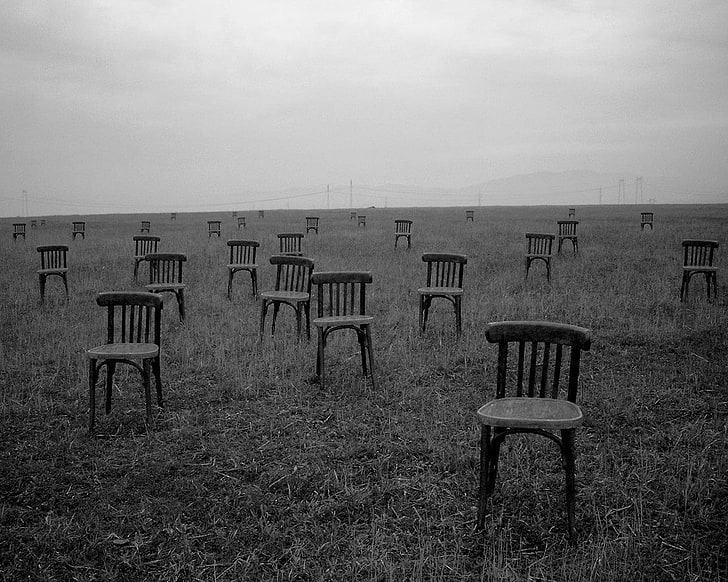

Это моя работа и другую мне не сыскать. И хотя время от времени мне приходится говорить людям неприятные вещи, которые я мог бы и не говорить, ведь меня никто не проверит, я все же стараюсь выполнять свои обязанности добросовестно. Уж если взялся за что-то серьезно — будь честным и ответственным до конца, даже если порой это идет наперекор твоим принципам, идеалам, стремлениям и тем более, если это противоречит твоим убеждениям.

И все же, этому старику, покрытому морщинами как известняковая скала, с мокрыми, уставшими глазами, меня не понять. Он закрывает дверь бормоча проклятия или просто сетуя на несправедливую и уродливую бюрократию, что безжалостно налагает на него свои, несоизмеримые его проступку, унизительные санкции.

— Постой! — кричу я ему в отчаянии, пока дверь не соприкоснулась с рамой и витражное стекло не поглотило отсвет его бежевой рубашки, — Постой и послушай!

Но поздно, дверь захлопнулась и его призрак растаял в сиреневых и желтых красках.

Мысленно колочу порог и пытаюсь дотянуться до старика. Он был не прав, это точно. Но что мне, клерку, самого низшего покроя, известно о его чувствах? Что я, жалкий винтик в этой бездушной машине знаю о его судьбе, его прошлом и настоящем? Станет ли ему легче, если я важно продекламирую ему во весь голос, что я лишь пешка, исполнитель чужой воли?

Я отхожу от порога и присаживаюсь на бордюр за которым клумба. Цветы полыхают в прекрасном полуденном солнце, привлекая пчел, их ароматы застилают двор и дорогу, которую я вижу сквозь потрясающую кованую ограду. Брусчатка здесь выложена мастерски — отличное место, все сделано на совесть, добротно. Эти садовники и каменщики, как и я, делают все безупречно. Едва ли они спрашивают себя или, что еще менее вероятно, упрекают в том, что безотчетно выполняют кем-то составленный план. Не это ли их работа.

«Они зарабатывают миллионы, обворовывая нас, что же вы, не можете хоть раз сказать им неправду, спасти от их алчных лап одного немощного старика?» Эти слова не выходят из головы. Они отвратительны, как же они ужасны. Они направлены точно в цель, туда где находится человеческая совесть, если она еще осталась. И режут они грудь безжалостно, убивая то, что там еще может трепетать и меняться.

— Правда никому не нужна, старик! У нас и без этого забот хватает! — кричу я безадресно и тут же встаю и ухожу, распахивая калитку шагаю на тротуар.

Ах какой нежный, теплый и безоблачный день. Дома такие пышные и такие яркие, стоят, как кремовые пирожные. Мой новенький “Ягуар”, припаркован рядом, его идеально отполированная поверхность блестит черным ониксом.

Вот я открываю дверцу и в изумлении замечаю, что в руках у меня ручка старого холодильника, вокруг покрытые мхом развалины и буйные травы обступили меня со всех сторон.

