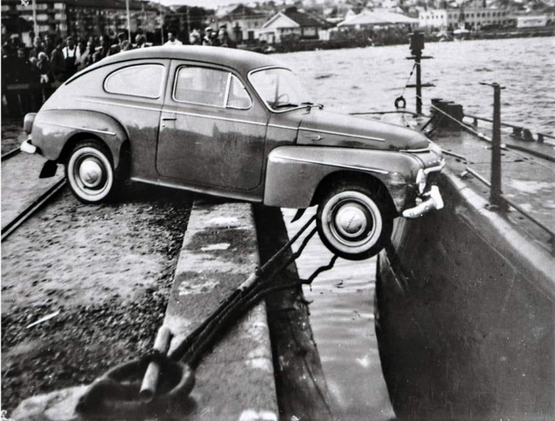
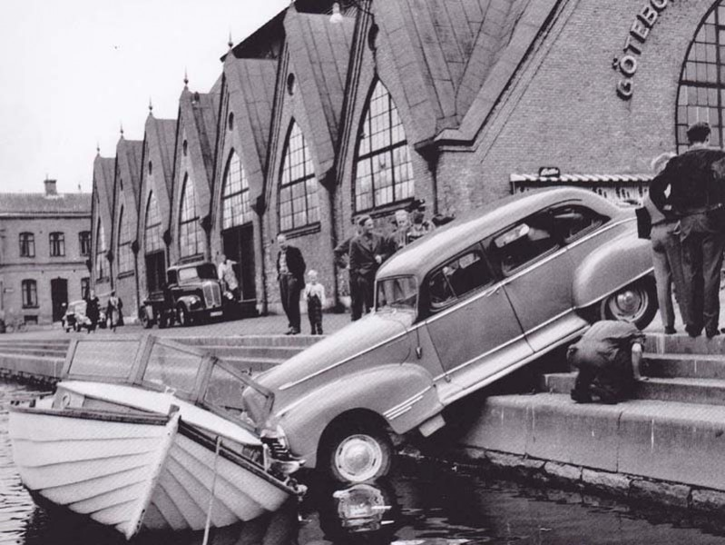

Как и в других странах, в Швеции, порой, случаются транспортные происшествия. Международная программа Vision Zero, разработанная в этой северной стране ставит перед собой задачу снизить к нулю количество смертей и травм на дорогах. И действительно, статистические данные королевства говорят о том, что такой подход достаточно эффективен.

Не удивительно, что в Швеции пришлось искать решение проблем транспортных крушений и коллизий, учитывая то, какие инциденты случались здесь в прошлом.

В моем эссе я хочу рассмотреть 3 наиболее вопиющих случая нарушения безопасности управления и эксплуатации транспортным средством.

[YouTube](https://www.youtube.com/embed/eVrtVNM8Jr4)

## Ваза

На острове Юргорден в Стокгольме находится музей средневекового судна. Толпы туристов стоят в очереди, чтобы посмотреть на мумифицированные останки легендарного корабля, который занимает первое место в моем предвзятом и необъективном исследовании.

Прекрасный и одновременно пугающий своей избыточностью и неуклюжестью, этот образец тщеславия выставлен на всеобщее обозрение для демонстрации мощи и несокрушимости королевского флота Швеции образца XVII-века.

Это чудо инженерной мысли, флагман военного флота, один из наиболее массивных и дорогостоящих кораблей на Балтике на момент создания, оснащенный по последнему слову техники и спущенный со стапелей летом 1628 года затонул при своем первом рейсе, не успев даже выйти из гавани. По меркам морских судов, можно сказать, что «Ваза» ушел ко дну, едва сделав первый шаг.

Для постройки этой грандиозной посудины было срублено 16 гектаров дубового леса, которые вместо того, чтобы бороздить суровые моря, благополучно покоились на дне 333 года, пока наконец были извлечены, реставрированы и отправлены в музей.

Известно, что активное участие в постройке «Вазы» принимал сам король - наглядная демонстрация того, что менеджерам не стоит вмешиваться в работу инженеров.

Шведы, нужно отдать им должное, смогли все же извлечь выгоду из этого деревянного, изначально бесполезного исполина - музей корабля является самым посещаемым в Швеции.

## Столкновение автомобиля и подводной лодки

На втором месте в моем рейтинге - ДТП между автомобилем Вольво и подводной лодкой. Звучит, как эпизод фильма о Фантомасе.

Дело было в 1961 году в шведском городе Люсечиль (Lysekil). Припаркованный у здания телефонной станции Volvo PV544 внезапно начал движение в сторону причала. Беспилотный автомобиль курсировал между бочками с сельдью, которые только что выгрузили из судна прибывшего из Исландии, миновал фонарный столб, пересек улицу идущую вдоль моря и наконец, перевалившись через бордюр, врезался в носовую часть пришвартованной подводной лодки Bävern, повредив ей релинг. К счастью, никто в этом инциденте не пострадал. Подводная лодка служила еще почти двадцать лет, а автомобиль вероятно расстреляли. Хотя конечно, поскольку дело было в Швеции, то я склонен полагать, что Volvo дали небольшой срок, который он благополучно провел на службе у местного радиста.

## Я убью тебя лодочник

Довольно редкое и, безусловно, дерзкое происшествие было зафиксировано в другом Шведском городе. В этот раз автомобиль врезался в боковую часть лодки. Инцидент произошел в Гетеборге в 1956 году, рядом с рыбным рынком (Feskekôrka).

Смею предположить, что водитель Hudson заявил следователю о своей невиновности примерно такими словами:

“Я припарковался и отправился купить свежую скумбрию на рынке, но когда я вернулся, лодка уже врезалась в передок моей ласточки. Без сомнения, какой-то лихач, иммигрант без документов на право управления водным транспортом. Вы только взгляните, что он сделал с моим хромированным бампером!”
