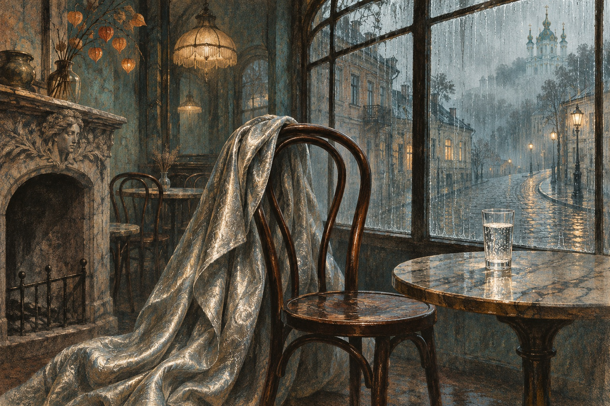

Снилось мне утро после бури. Тихое, дремлющее. Черное рождество окутало холмы красным платком. Я вышел наружу и долго стоял, расправив плечи в тумане, как коршун на грязном камне. Видел вдалеке, как Мултан радостно гонит табун лошадей в степь.

Вдохнув холодный воздух, я ступил в чужие земли, в город, где надо мной глумилась прокаженная блудница. Фронтоны зданий были такими же массивными, как и призрачные изваяния вдоль дорожки фонтанов, на которую я забрел. Здесь, в этом царстве винограда, песка и бирюзы, я нашел тенистую аллею, где смог укрыться от палящего солнца. Повсюду сновали брадатые купцы в желтых, сиреневых и лиловых тюрбанах. Они глядели на меня как на зачарованное животное. Один из них, белобородый, с глазами кобры, предложил мне раскурить с ним кальян с каким-то новым видом табака. Я немедленно согласился и сел на пол, прищурившись. Он первым пригубил дым, и я видел, как он дрожит, словно неудачно подстреленная лань; его коробило до неузнаваемости, но при этом он сохранял абсолютную невозмутимость. Но стоило мне вдохнуть этот едкий дым, и я тут же оказался у музея Кавалеридзе на Андреевском спуске. Причем дождь, который в это время омывал Подол, как-то непривычно топтался у меня на голове, и в порыве стряхнуть с волос капли я обнаружил, что совершенно лыс. То был момент всеобщего ликования — так как из окон домов все утвердительно закивали. Я решил укрыться в ближайшем кафе, где мне, совершенно одинокому и молчаливому гостю, без какой-либо надобности принесли спагетти с молодой телятиной и стакан газированной воды.

— Боюсь, я не в силах буду с вами рассчитаться, — промолвил я официантке, которая бестактно и неуместно бросила на меня свой жеманный взгляд. Она робко сорвала с себя фартук и ушла. А через минуту я видел в окне, как она вскочила за спину какому-то мотоциклисту и укатилась вниз, прочь из поля моего зрения. Так я остался один в уютном, но пустом кафе.

Едва закончив трапезу и ворочаясь от скуки, я заметил на спинке стула, что стоял позади меня, серебряную мантию. Я помял ее в руках и обнаружил на внутренней стороне странную нашивку. Она гласила: +5 к газетам, -17 к харизме. «Нелепая мантия», — подумал я и швырнул ее в камин, так как ни лацкан, ни манжеты не соответствовали данному образцу (типу мантии). Но она оказалась с сюрпризом, неожиданно вспыхнув в холодном камине. Тут же из нее полезли черти и устроились плясать, норовя ускользнуть в дымовую трубу. Лица их были злые, напыщенные. В общем, мне здесь стало совсем неуютно, и я поспешно ретировался.