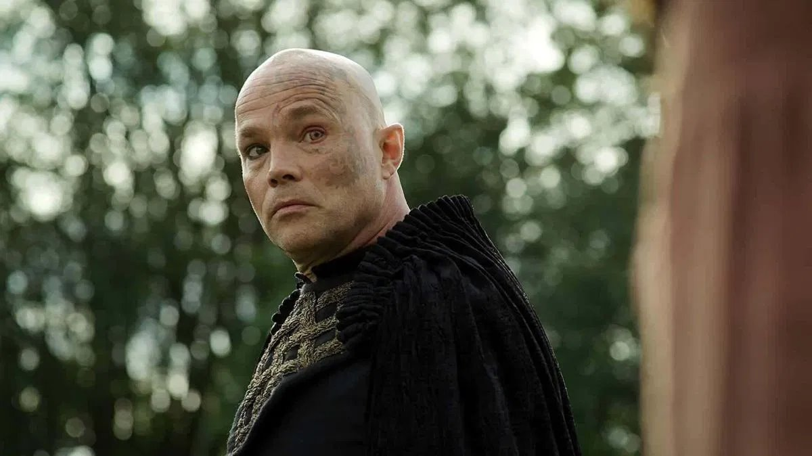

В древние времена сказывали об одном человеке, который не мог ужиться со своей истинной природой. Он был одержим формой, в которую был заключен. Его привязанности сослужили ему дурную славу и пришло время, когда он начал безвозвратно терять то, что так стремился экспонировать, упиваясь собственным великолепием. Неврастеник, который вместо бесценных добродетелей обременил себя мучительной привязанностью к тленному своему существу. И судьба наказала его беспощадно, как наказывает всякого, кто дорожит лишь тем, к чему может дотянуться. Богач не в состоянии остановиться, алчность довлеет над ним. Тщедушный трясется над своими пожитками. Лишь Вини-пух пребывает в гармонии с самим собой - он постиг Дао, он и есть Дао. Но Винни-пух чрезвычайно уязвим в реальном мире. Он совершенно искренен и безукоризненно доверчив. Блаженный, он может существовать лишь как абстракция. Но герой сказания, напротив, реален и потому он выбирает путь бесконечного насилия. Так как он не может преодолеть психологический кризис, мистер Хайд полностью завладевает его личностью на фоне посттравматического синдрома. Хайда не волнует форма, он одержим Асмодеем. Пытаясь насытиться своим деструктивным самовыражением, он становиться все более и более несчастным. Так происходит его погружение в кипящую и клокочущую бездну шеола, где его настигают гримасничающие асуры.
